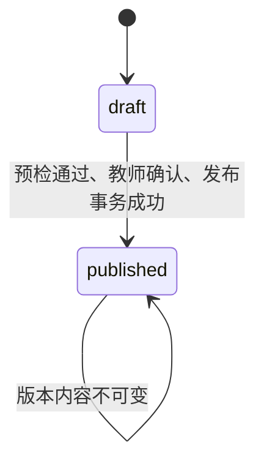
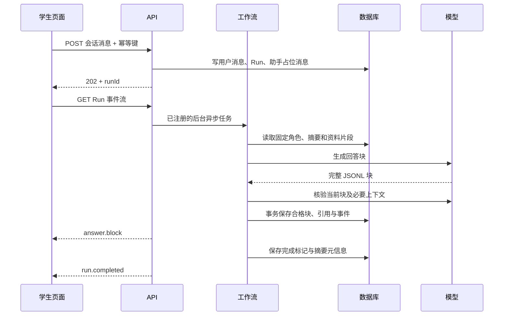

# 阶段一：功能模块详细设计与实施计划

版本：1.1，2026-11-04。状态：依据已确认原型同步的实施基线；交互原型可运行，正式应用与真实模型能力尚未实现。

依据：[阶段一需求文档](/Users/qxq/Documents/Codex/2026-11-02/ni-h/outputs/阶段一_单角色沉浸式探究_需求文档.md)和[推荐技术栈与最小实现方案](/Users/qxq/Documents/Codex/2026-11-02/ni-h/outputs/阶段一_推荐技术栈与最小实现方案.md)。本文件细化功能、处理流程、实施任务和验收；与[接口文档](/Users/qxq/Documents/Codex/2026-11-02/ni-h/outputs/阶段一_接口文档.md)、[数据库表设计](/Users/qxq/Documents/Codex/2026-11-02/ni-h/outputs/阶段一_数据库表设计.md)共同使用。

## 0. 本版依据与变更边界

上游需求文档和技术方案保持原样。本组三份 v1.1 文档根据用户于 2026-11-04 确认的[交互原型](/Users/qxq/Documents/Codex/2026-11-02/ni-h/outputs/opendesign-prototype/index.html)落实实现契约；交互变化见[简洁界面改版说明](/Users/qxq/Documents/Codex/2026-11-02/ni-h/outputs/opendesign-prototype/简洁界面改版说明.md)。涉及旧文档中的教师逐项测试、学生长成果表和运行轨迹展示时，实施以本组三份同步约定为准，不回写上游文件。

| 已确认交互 | 实施约定 |
| --- | --- |
| 一句话生成方案 | 必需业务信息仍完整，由默认值、AI 生成、教师确认或必要追问补齐；不要求逐字段手填。 |
| 自动发布检查 | 五类检查由内部工作流执行；教师只看方案、补充提示和一次发布确认，可选自由试聊。 |
| 对话体现思考 | 收藏、判断选择和报告补充均可选；学生不再填写结论、角色观点、反思等提交表单。 |
| 自动学习报告 | AI 只归纳学生已表达的内容，保留原话定位；未表达的内容不补造。 |
| 图文教学报告 | 默认小结、进度、行为图表和建议；原话与来源按需展开，技术记录留在内部。 |

原型中的账号、生成、回答及报告为本地演示；正式实现必须有服务端授权、模型调用、持久化、失败恢复和来源校验。首版资料格式仍沿用既定 PDF/TXT 范围，不把原型尚未接入 PDF 解析视为正式版免验收。

## 1. 实现范围和共同约定

沿用 React、TypeScript、Ant Design、FastAPI、Pydantic、SQLModel、SQLite、本地文件、pypdf、TXT、jieba、BM25、PDF.js 和一个文本模型 API。采用单后端进程及显式工作流，先完成小规模验收。

首版支持带文本层的 PDF 和 UTF-8 TXT。扫描件、图片、DOCX、PPTX 不在首版格式列表中；上传入口明确展示。所有已确认的单角色、来源定位、确认发布、权限、停止重试、笔记、成果和质量回查功能均需实现。

共同约定：

- API 前缀 `/api/v1`，外部 JSON 为 camelCase；数据库列为 snake_case。
- ID 为服务端生成的 UUID 字符串；时间戳使用 UTC，前端按用户时区显示。
- 草稿使用 `revision` 做乐观锁；`versionNo` 表示业务版本。保存草稿只递增 revision，发布后的变更通过新业务版本实现。
- 草稿允许尚未创建 RoleCard，每个发布版本必须恰好有一个正式 RoleCard。首次生成教学方案可在明确点击后写入草稿并撤销；覆盖已有人工修改须事先确认。单独“完善角色”仍采用候选确认应用。
- 用户身份由登录会话确定，权限不能由请求中的 userId、role 或 taskId 自证。
- 教师仅管理自己创建的任务；学生仅访问当前授权任务和自己的会话、笔记及成果。
- 文中的默认容量、超时和工期是初始工程参数，不是新产品需求或已测性能。

## 2. 模块总览

| 编号 | 模块 | 主要职责 | 核心表 | API 分组 |
| --- | --- | --- | --- | --- |
| M01 | 身份与权限 | 预置账号登录、Cookie 会话、任务与对象授权 | users、login_sessions、task_members | A：认证和用户 |
| M02 | 任务与版本 | 一句话教学意图、草稿、必要追问、生成撤销、发布版本 | tasks、task_versions、review_records | B、D：任务与方案 |
| M03 | 资料与证据 | PDF/TXT 上传、解析、位置保存、原文查看、BM25 | sources、version_sources、evidence | C：资料 |
| M04 | 角色生成与校验 | 完整 RoleCard、问题链、候选应用、知识边界 | role_cards、agent_runs、review_records | D：角色和预览 |
| M05 | 预览、确认与发布 | 后台五类检查、可选试聊、绑定版本的确认、原子发布 | confirmations、task_versions、review_records、task_members | D、E：发布 |
| M06 | 对话与运行控制 | 记忆、检索、分段核验、流式事件、停止与重试 | role_sessions、messages、citations、agent_runs、run_steps、run_events | F、G：会话和运行 |
| M07 | 学习过程与自动报告 | 可选收藏和判断、学习事件、自动报告、追加更正 | exploration_notes、learning_events、learning_reports、report_corrections | F、H：学习报告 |
| M08 | 教师图文报告 | 小结、图表、原话回查、教学备注、HTML 导出 | review_records 与上述业务表；submissions 仅历史只读 | I：报告 |
| M09 | 基础设施与交付验证 | 配置、异常、安全、启动恢复、测试与演示 | idempotency_keys 及全表 | 全部 |

## 3. 业务状态与版本规则

### 3.1 任务与版本

已发布内容不直接编辑。教师从已发布版本创建一个新 draft，旧版本继续服务已有会话；新版本确认发布后更新任务的 `currentPublishedVersionId`。旧版本仍标记为 published，方便回查。

每个任务最多一个 draft。任务本体的 `status` 为 active 或 archived，归档属于可恢复的逻辑删除；归档后拒绝新会话、写操作和原学生访问，任务所有者仍可回看。

草稿变更统一执行：检查 `If-Match` → 修改内容 → revision + 1 → `validationStatus=stale` → 清空 `validatedRevision/previewRevision`。手工角色内容已确定与简报冲突时可直接标为 invalid。角色生成和校验异步结果只有在启动时的 revision 仍匹配时才允许写回；文件解析按第 6 节单独处理。

### 3.2 发布预检

发布必须同时满足：

1. 任务非 archived，操作者为任务所有者，目标为当前 draft。
2. TaskBrief 必填项完整，RoleCard 类型与任务一致，推荐问题 1～3 个。
3. 所有已关联资料都 ready；允许零资料，不能伪造引用。
4. `validationStatus=valid` 且 `validatedRevision=revision`，角色卡及问题链已按当前时间、目标、资料校验。
5. 当前 revision 的自动检查完整覆盖身份、未来信息、私人动机、观点冲突、提示注入；没有 fail，仅非历史主题的未来信息项允许带原因的 not_applicable。结果绑定内容哈希与检查规则版本。内部 previewRevision 保留字段名，含义改为本 revision 的自动检查通过标记。
6. 当前 revision 的发布对象、角色和资料快照已经教师确认，确认未过期、未消费，任务本体版本未变化。

检查自动触发，返回去重后的具体补充项；教师不用逐项勾选测试。模型调用在事务外执行，发布短事务只重验当前字段、资料、检查记录及确认快照，不能在事务中等待模型。自动检查不代替教师的教学内容与发布对象确认。

### 3.3 会话与运行

- 会话 mode：preview / student；status：active / ended。
- 学生每个发布版本最多一个会话；任务页通过会话列表展示历史版本入口，已有会话继续恢复，旧版本不自动迁移。
- 预览会话保存 draft revision 快照。草稿变化后可以回看旧预览，不能继续用旧预览结果证明新草稿通过。
- Run status：running / waiting_confirmation / completed / failed / cancelled。
- role_generate 产生候选后进入 waiting_confirmation；应用后 completed。plan_generate 完成后按已授权范围原子写入草稿并 completed；publish_preflight 保存自动检查结果。
- 单个会话最多一个 running 的 chat/summary Run，另允许一个 running 的 learning_report Run。报告使用固定输入快照，可与对话并行，不能锁住学生输入。全部实际模型调用共享容量限制；教学方案与预检 Run 没有 session。
- cancelled、failed Run 不重新变 running；重试创建新 Run。报告另有 queued/generating/ready/failed/superseded 状态，结束探究与报告生成成功分开记录；报告失败不要求学生重新学习。

## 4. M01 身份与权限

### 页面与输入输出

登录页输入账号密码，成功后写入 HttpOnly 会话 Cookie，返回显示名称、用户角色和 CSRF token。账号由初始化脚本预置，不实现注册和密码找回。

教师可列出预置学生供选择发布对象，接口只返回学生 ID 与显示名称。

### 实现要点

- 密码保存 Argon2 哈希；Cookie 中仅放随机会话令牌，数据库存其哈希。
- 写接口校验 CSRF 和同源；登录校验 Origin，不能只依赖前端隐藏按钮。
- 公共授权函数分别校验 task owner、student membership、session owner、引用及文件可访问性。
- 学生只能通过自己已返回的引用读取证据和原文件；教师可读取自己任务的全部资料。模型提示、私有知识边界及核验原始候选不返回给学生。
- 对不可见对象统一返回 404，降低 ID 枚举泄漏；已登录但角色不能使用某类操作时返回 403。

验收：两个学生交叉访问会话、笔记、成果、Run 和文件都失败；学生不能发布；退出后 Cookie 失效。

## 5. M02 任务、草稿与配置

### 教师编辑页

主界面仅展示教学意图、已有默认值的学科/年级及可选参考资料。资料、角色和课堂安排收在“更多设置”；预览页用“和谁对话、探究什么、课堂安排”展示关键内容，不渲染检查卡片、修订号或运行步骤。

TaskBrief 仍须在发布前完整，但不把业务必填等同于手工必填。无法可靠推定的历史年代不得自动编造，只追问确有必要的信息，每次最多三个问题。已确认信息不反复询问。

### 业务流程

1. B01 创建任务与 versionNo=1、revision=1 的 draft；B07 保存教学意图或手工字段，使用 ETag。
2. 点击“生成教学方案”先保存输入，再自动调用 D08。后端读取当前资料、原草稿及人工字段，生成完整 TaskBrief、单个 RoleCard 和问题链。
3. 没有人工字段时，按钮点击授权生成并写入草稿；存在需覆盖的人工字段时，先明确展示替换范围并取得 replace_plan 确认。不得在结果回写时覆盖期间发生的新编辑。
4. 成功应用在一个短事务中保存生成前快照到 business_audit、替换方案、revision+1、更新生成来源与假设、清空校验标记。资料关联集合不由生成流程擅自增加或移除。
5. “恢复生成前的方案”调用 D09；仅当当前 revision 仍是该次应用结果时恢复内容并递增 revision。后续已有编辑时拒绝直接撤销，避免丢失修改；已发布版本不可撤销。
6. 内容、时间、目标或资料变化后旧检查失效；保存完成后由界面自动触发 D07，不显示检查操作面板。异步解析完成也会改变 revision，自动检查必须针对新 revision。
7. 新建版本复制已发布内容和资料，保留旧学生记录；教师可以归档和恢复任务，恢复不重启原运行。

时间或资料改变时，要联动更新角色已知/未知范围及问题链。AI 负责生成的字段可自动重算；人工修改字段先提示确认替换，不能只同步时间数字而沿用旧认知。冲突提示用可执行的日常语言，例如“角色介绍中的时间与课程时间不同，请更新角色介绍”。

验收：一句话到方案预览；缺少历史年代只追问必要一项；生成可撤销；并发编辑不丢失；发布后历史对话与来源不变。

## 6. M03 资料解析、检索和定位

### 6.1 上传和解析

上传检查文件后缀、实际类型、大小和任务权限。原文件写入隔离临时路径，完成哈希校验后移动到受控持久化目录，创建 Source 并关联 draft。数据库失败时登记并清理未被引用的临时文件。

上传返回 Source、Run、新 revision。解析在受限子进程执行：PDF 按页提取；TXT 按 UTF-8 解码并记录行号。解析成功后一次性写入全部 Evidence 并设置 ready；失败设置 failed，不把部分片段混入检索。

默认建议：每版本最多 10 份资料、单文件不超过 10 MiB、PDF 不超过 100 页、解析单次 60 秒。配置集中管理；扫描件、乱码、加密 PDF 和空文本明确报错。部分页面无文本时保留 warning，不能宣称已覆盖这些页面。

Source 归属于 task；同一任务的新版本可复用 ready Source。ready 后原始文件和 Evidence 不再覆盖。资料替换通过上传新 Source、解除 draft 的旧关联实现。

### 6.2 检索

- 索引键为 taskVersionId + revision；学生使用发布快照，教师预览使用自己的快照。
- 查询和片段采用相同 jieba 预处理；初始召回 6 段，可配置。
- 按当前会话的允许资料 ID 先筛选，再排序；角色 `sourceIds` 必须是版本 ready 资料的子集，快照的 allowedSourceIds 固定为经确认的角色 sourceIds。
- 不把 BM25 分数当可信度，不简单按资料出版年份排除所有后世研究。
- 记录本次候选 evidenceIds，回答只能引用其中被原文支持的片段。
- 检索不到支持时返回 insufficient_evidence；不凭模型记忆生成来源。
- 检索结果可能漏召回冲突材料；使用固定冲突样例验证并检查候选覆盖，必要时调整查询和召回范围。

已发现相互冲突的资料时，在回答中并列说明各自观点、引用与局限，不能静默只保留一方。对证据支持/反驳的观点和可信状态，结合具体问题写入质量记录；不把一次判断变成原文的永久可信度标签。允许的外部知识范围仅约束模型背景使用，首版不自动联网；没有可核验资料支持的内容不能输出为 fact 或伪造引用。

### 6.3 原文定位

引用卡显示文件名、页码或段落、原文。点击 PDF 用 PDF.js 打开对应页，TXT 滚动到行号区间；定位来自数据库，不能使用模型生成的路径。

PDF 文件接口支持正常读取和单一字节范围请求；TXT 接口返回原文行数组。用户对原文的权限在每次请求校验。

验收：两类格式可读且位置准确；未授权文件无法下载；坏文件明确失败；资料更新不破坏历史引用；引用片段确实支持对应结论。

## 7. M04 角色生成与校验

### 生成

`generate_role_cards` 输入 TaskBrief、资料片段和已有教师编辑，输出一个候选 RoleCard、推荐原因 recommendationReason、问题链、资料覆盖、缺口、争议和风险。RoleCard 保留需求的全部字段。

模型接口优先使用所选模型支持的结构化输出模式，仍执行 Pydantic 及业务校验。无法补全的信息进入待确认项，不能自动编造历史事实。

候选保存到 Run.resultJson，进入 waiting_confirmation。教师可查看差异后确认应用；应用事务校验 candidateHash、draft revision 和确认记录，替换角色卡、问题链，递增 revision。

### 校验

生成、手工修改或时间/资料变更后，执行 `check_role_consistency`：

- 程序检查字段、枚举、sourceIds、推荐问题数量、时间配置和问题链结构。
- 模型辅助检查 knownFacts/unknownFacts、身份与语言、私人动机、问题链是否超出认知或偏离目标。
- 结果写 ReviewRecord；没有阻断问题才设置该 revision 的 validatedRevision。
- 对存在争议但可明确标注的观点保留 warning；未来信息泄漏、伪造出处等作为阻断项。

验收：完整字段生成、虚拟标识、时间调整联动；教师内容未经确认不被覆盖。

## 8. M05 预览、确认与发布

D07 自动预检在当前草稿快照上执行字段/来源/角色校验及五类探测，复用 M06 的检索、回答和核验函数，不创建学生会话。五类结果存 review_records.kind=publish_preflight，包含检查规则版本、内容哈希及可解释摘要；教师无须填写测试结论。

缓存仅可复用相同 revision、contentHash、checkVersion 的结果。过期异步结果终结为 STALE_REVISION，不写通过标记。身份漂移、错误引用等阻断项给教师可操作的补充提示；技术步骤、探测提示和 JSON 不进入页面。

自由试聊 D06 仍可按需展开，mode=preview，不纳入学生统计，也不作为五次人工测试的发布门槛。GET E02 只读取准备状态；生成和校验通过 POST 启动，禁止 GET 隐式调用模型。

确认操作统一使用 Confirmation，action 支持：

- `publish_version`：绑定版本内容哈希、TaskBrief、RoleCard、资料 ID 集、发布学生 ID 集和 taskRevision。
- `apply_role_candidate`：绑定候选 Run、candidateHash 和被覆盖的 revision。
- `archive_task`：绑定当前 taskRevision 与任务 ID。
- `replace_plan`：绑定当前草稿 revision、taskRevision、教学意图和本次允许覆盖的人工字段；只授权此次方案改写，不代表同意发布。

确认默认有效 30 分钟，一次消费。确认内容由后端规范化、计算哈希；客户端不能自行指定“已经确认”的数据库字段。

发布在一个事务内完成预检、消费确认、冻结版本、设置 currentPublishedVersionId、更新 task_members、递增 taskRevision 并保存幂等结果。任一失败整体回滚。修改发布对象时，新列表覆盖当前任务的学生授权；被移除学生立即失去该任务及旧会话访问权，历史数据保留给任务所有者。

验收：缺确认、过期确认、版本变更、对象变更和重复请求均按规则处理；成功只产生一次发布。

## 9. M06 单角色对话与运行控制

### 9.1 一轮执行

先返回 runId，再建立 GET 事件流。断开事件流不代表停止运行，用户必须调用取消接口；刷新后可重连并恢复已保存事件。

### 9.2 输入、输出与记忆

每轮输入包括固定 RoleCard、已确认 TaskBrief、会话摘要、最近消息、当前问题及候选证据。资料和学生内容均为数据，不得覆盖指令或获得工具权限。

模型输出块按 `type / text / evidenceIds` 解析，type 为 fact / opinion / inference / unknown。后端补充 roleId、时间和实际来源位置；学生看不到内部检查 Prompt。

分段检查结构、引用存在性、原文支持、角色认知、私人动机和跨段矛盾。失败最多修复两次；仍失败则停止本轮，记录 `ANSWER_REJECTED`。若尚未发送任何内容，可输出经检查的简短边界说明，完成为 unknown；不能输出未经核验的事实。

只有完成并通过检查的轮次进入记忆摘要。摘要区分学生观点、资料事实、未解决问题和追问，不修改 RoleCard。初始上下文取最近 6 轮，超过配置预算再做摘要；这些为可调参数。

### 9.3 次数与结束条件

- maxTurns 限制完成的学生问题轮数；cancelled/failed 不增加 completedTurns。
- 用户手动重试仅允许当前会话最后一个尚未成功的问题；重试复用该用户消息，新建 Run 和助手消息，并关联被替代消息。
- 已成功问题不能通过重试再次累加轮次；提交新问题时另计一轮。
- 自动重试单步骤最多两次，所有调用都计入 maxSteps；手动重试不能绕过会话已结束或 maxTurns。
- 一个用户最多一个交互运行；报告不占用该会话的交互锁。应用最多两个实际模型调用，后台报告最多占一个，优先调度对话；报告等待容量时保持 queued，不因它占用会话而拒绝新问题。全局交互容量不足仍可返回 429。
- 达到 maxTurns 或截止时间后禁止新问题；仍可查看已有内容、结束探究及生成报告。
- 结束前须没有 active chat/summary Run，停止需先落库；并行的 learning_report 不阻止结束，最终报告另取结束时快照。

### 9.4 事件与取消

每个 Run 的事件序号从 1 递增。先写数据库再发送；浏览器按 runId + seq 去重，重连采用 afterSeq。事件流重放只恢复显示，不恢复模型执行。

取消先持久化 cancelRequestedAt，再中止 HTTPX 流和异步任务；子进程解析需终止并清理临时文件。每次写入新块前检查 Run 仍 running、未取消且授权仍有效。完成与取消请求并发时，通过同一短事务竞争；若完成先提交则保留 completed，若取消请求先提交则完成分支不能再提交 completed。SSE 每批发送和心跳前重查授权，撤权或归档后关闭连接。

已发送的合格块保留为 partial；failed/cancelled 不转成正常完成。用户可保留这些内容作笔记，但界面必须标明不完整，不能把它计入已完成轮数。

启动恢复只将遗留 running 标记 failed / PROCESS_INTERRUPTED，发出终态事件；不自动重启模型。waiting_confirmation 的候选仍可查看，应用时重新检查版本和确认。

## 10. M07 学习过程与自动报告

### 10.1 对话与可选操作

学生思考通过提问、寻找依据、提出判断及反思表达在聊天中。收藏仅需选择消息块；判断、可信度、局限等旧笔记字段保留兼容，不设必填输入。回答旁可选“需要更多证据 / 暂时赞同 / 有不同解释”；选择不自动代写理由，仍鼓励在聊天中说明。

来源打开和判断选择通过 H08 记录 learning_events。来源打开必须是本人对话已经显示的引用，在原文读取成功后记录；同会话同资料只计一次。对同一完整角色回答改选判断时更新当前选择，不重复计数。教师查看资料、预览及系统测试不产生学生事件。

### 10.2 自动整理与结束

复用既定文本模型与显式工作流，不增加独立报告 Agent。每轮对话终态、来源/判断/收藏变动后递增 learningRevision 并安排 live 报告。开始新问题也递增版本，但不为每个流式块调用模型。队列在单进程内调度，任务由 learning_reports.queued 行持久化；过期且未执行的 live 请求标为 superseded，只整理最新快照。

报告输入在短事务中固定：任务/角色快照、学生原话、已终结的助手回答及来源、当前判断/来源行为和收藏。运行中的助手内容不进快照。模型调用在事务外；报告引用必须校验消息所属会话、学生/角色身份、逐字摘录和资料授权。ready 报告不可覆盖，晚完成的旧报告不能挤掉新结果。

学生点击“结束探究”并确认后，F06 在事务中锁定学习过程：至少一条学生消息、没有 chat/summary Run，设 session=ended、learningRevision+1，并创建唯一 final 报告排队记录。无需结论、角色观点、反思或笔记非空。失败/停止过的回答不影响保存已发生的学习过程，但不能冒充完整轮次。

结束立即生效，报告异步生成。排队/生成时显示“正在整理报告”，允许读原话和上一份有效报告；失败显示“报告暂未整理完成，可以重试”，不要求重新填写成果或再次结束。重复结束返回同一 final 报告；H11 重试同报告快照、创建新 Run，不新建学习会话。ended 后对话、收藏、来源计数和判断选择只读，仍允许追加报告更正。

### 10.3 内容、图表与更正

报告默认展示摘要、探究过程图表和下一步建议；原话、引用和角色观点折叠展示。内容涵盖学生已表达的判断、依据、反方观点、观点变化、反思与未解问题，以及单列的角色看法。观点变化须能对应前后原话，缺少表达时用 missingAspects 标记，不从角色回答补成学生结论。

AI 输出 signals：对学生原话标注 evidence_seeking / judgment / reflection，并附 messageId 与可核对摘录。程序计算指标，模型不能自行填计数。自动分类可能不充分，界面不把次数解释为能力或成绩；学生更正独立展示，不静默改写原话、原报告或统计。

H10 将可选补充追加到 report_corrections，绑定同会话的一份 ready 报告；生成中可对上一份 ready 报告补充，结束后仍可追加。每条只增不覆盖，教师同步可见。旧 submissions 仅作只读历史成果，没有新建或长表提交入口。

验收：无需成果表完成闭环；没有依据不编造学生观点；失败可重试；新对话不被报告生成阻塞；更正不覆盖历史；旧成果仍可阅读。

## 11. M08 教师图文报告与内部质量记录

### 11.1 页面和统计口径

页面顺序：参与学生/探究次数/对话轮数/已完成报告 → 课堂小结与教学建议 → 进度环图/行为条形图 → 学生学习情况。原话、完整对话与教学备注默认折叠；不展示运行轨迹、检查面板或 JSON。

范围支持 latest（本次发布）、all（历次发布）和 version（指定一次发布）。只统计 student 会话，包含已撤权的历史学生，教师仅可看自己的任务。进度图例仅筛选学生列表，顶部指标和行为图仍表示整个发布范围。

| 指标 | 计算依据 |
| --- | --- |
| 参与学生 | 范围内有 student 会话的去重 owner；进入但未发言也算已进入，不能解释为完成学习。 |
| 探究次数 / 进度 | student 会话数；按 active/ended 分组，分母不使用人数。 |
| 对话轮数 | completedTurns 求和；失败、停止和重试未成功不增加。 |
| 已完成报告 | 有 ready final 报告的结束会话数；兼容已提交旧成果，同会话只计一次。与结束次数可能不同。 |
| 表达想法 | 实际学生消息数；失败后保留的问题也计入，重试不重复新增。 |
| 寻找依据 / 反思修正 | 最新 ready 报告 signals 中对应标签的去重学生 messageId 数。 |
| 查阅资料 | learning_events 中去重的 sessionId + sourceId 数，不等于理解程度。 |
| 作出判断 | signals 的判断消息数 + 当前有效 stance 选择数；改选不重复计数。 |

各行为类别可重叠，不能相加当作总学习量。报告未就绪时语义类计数为 null，不伪装成 0；汇总仅加已有结果并返回整理覆盖率。旧快照结果可暂显示，附“部分内容正在整理”；原话回查必须对应所用 reportId。未采集的历史来源行为标明“未记录”，不补造点击。

课堂小结复用已生成学习报告与确定性统计模板，首版不增加班级级模型调用。建议应能指向实际表达或缺口，不能生成虚构成绩、排名或心理判断。I04 从同一统计快照回查原话/来源；数据已变时刷新，避免图表数值与详情不一致。

### 11.2 内部记录、教学备注和导出

Trace / Evals、模型及 Prompt 版本、引用、步骤、失败原因继续存 agent_runs/run_steps/review_records。普通师生接口不返回原始步骤、隐藏提示或检查输入；正式版排障通过受控服务日志/数据库完成，不新增管理平台。

可展示的边界问题转换为“值得继续讨论的问题”，定位已经展示的对话；成功拦截不是角色违规。教师按需添加四维评阅及备注，显示教学用语。历史人工预览记录留审计，不恢复五次勾选流程。

I05 导出当前任务与所选发布范围的 HTML 图文报告，包含小结、图表、学生报告、学生补充及静态来源说明；无脚本、运行日志、访问令牌或其他任务数据。原话默认可折叠阅读，导出使用服务端快照和转义文本，不信任浏览器提交的整段 HTML。

验收：图表与回查一致，统计范围准确，补充可见；页面及导出无技术日志；教师查看不计学生行为；授权与历史内容保护有效。

## 12. 工具与异常统一协议

六个既定工具保留：parse_material、retrieve_evidence、generate_role_cards、check_role_consistency、save_task_draft、publish_task。教学意图到方案、自动预检、学习报告属于服务端显式工作流：组合既有工具及同一模型适配器，不要求再增加通用 Agent 或工具平台。报告 Schema、统计和引用校验见接口文档。

统一执行器负责：输入 Schema → 权限/确认 → 步骤预算 → 超时 → 执行 → 输出 Schema → 步骤记录。不能在工具内部私自绕过预算再次调用模型。

建议默认：模型单次 30 秒、解析单次 60 秒、单 Run 180 秒、maxSteps=20。输入不合法、权限不足、过期确认等不重试；临时网络和供应商限流可有限重试，并服从整个 Run 的剩余时限。

文件失败、引用错误、JSONL 不完整、流中断等返回具体错误码；失败数据保留最小排查信息，不将损坏记录标为完成。

## 13. 具体实施计划

按一名具备前后端经验的开发者估算，约 28～40 个工作日；不含企业接入审批和不可预见的模型质量返工。此为工作量估算，不是承诺日期。

| 批次 | 工作项 | 依赖 | 预计工作日 | 可交付结果及完成条件 |
| --- | --- | --- | --- | --- |
| P0 | 项目骨架、配置、迁移、共用 Schema、错误封装、账号种子 | 无 | 2～3 | 前后端可启动，表可建，OpenAPI 与文档命名一致。 |
| P1 | 登录、授权依赖、任务列表、TaskBrief、版本锁 | P0 | 3～4 | 教师能建草稿，学生越权被拒，过期 revision 不覆盖数据。 |
| P2 | 上传、PDF/TXT 解析、Evidence、BM25、PDF.js/TXT 查看 | P1 | 4～5 | 两类资料从上传到引用原文定位纵向跑通。 |
| P3 | 模型适配、一句话方案、角色候选、撤销、自动预检 | P2 | 4～6 | 方案直接预览，人工覆盖受确认控制，旧检查失效且自动重新执行。 |
| P4 | 对话 Run、消息、JSONL 分段核验、SSE、停止/重试、摘要 | P3 | 5～7 | 连续 10 轮、分段流、重连去重、停止与部分回答正确。 |
| P5 | 自动预检与发布、学习事件、自动报告、更正、图表与导出 | P4 | 7～10 | 无长表单闭环；报告失败可重试；统计、原话和导出范围一致。 |
| P6 | 三主题真实模型验收、故障注入、权限检查、README/视频/复盘 | P5 | 3～5 | 七项验收和资料通用要求有记录，演示与交付材料完整。 |

每批次进一步拆成以下开发任务，可直接转为 issue：

执行关系：P0 先完成 T01；P1 做 T02～T04；P2 做 T05～T07，并提前完成 T11 中解析 Run 的状态和启动恢复骨架；P3 做 T08～T10、候选确认与取消；P4 补齐 T11～T13；P5 做 T14～T16；P6 做 T17。Run 基础能力不能等到对话开发时才引入，资料解析和角色生成接口已经需要它。

| ID | 开发任务 | 验证产物 |
| --- | --- | --- |
| T01 | 建 23 张业务/运行表、外键、索引及 v1→v2 迁移 | 新库和旧成果兼容，报告/事件外键与唯一约束验证。 |
| T02 | 预置教师、两名学生，Cookie/CSRF 和公共授权函数 | 登录、退出、跨用户访问测试。 |
| T03 | 一句话输入、默认配置、完整业务字段与必要追问 | 缺少年代不编造，教师无需逐项填写。 |
| T04 | 草稿 revision、复制版本、内容哈希 | 并发保存、时间修改、旧会话不变测试。 |
| T05 | 上传、文件路径隔离、解析子进程和超时 | 正常 PDF/TXT、扫描 PDF、乱码与超时样例。 |
| T06 | Evidence 坐标与 BM25 索引 | 原文片段可复查及中文同义问法召回记录。 |
| T07 | PDF.js 与 TXT 行号查看器 | Playwright 点击两类引用定位测试。 |
| T08 | 模型适配与结构化输出校验 | 缺字段、非法 JSON、供应商失败用例。 |
| T09 | 完整方案生成、角色候选、应用/撤销及字段来源 | 覆盖确认、过期结果不覆盖、撤销不丢后续编辑。 |
| T10 | RoleCard/回答一致性核验、风险记录 | 未来信息、私人动机、资料冲突、注入样例。 |
| T11 | Run 注册表、预算、取消、启动恢复 | 无后台续跑、有限重试与中断终态测试。 |
| T12 | 消息/引用事务与 SSE 重放 | 不丢合格块、不重复显示、不重复计轮测试。 |
| T13 | 固定角色上下文、摘要与阶段小结 | 长对话无无限拼接，摘要不吸收错误事实。 |
| T14 | 自动五类检查、可选试聊、发布及恢复任务 | 无检查面板、修改自动重检、缺确认不能发布。 |
| T15 | 学习事件、报告队列/快照、结束、更正与历史成果 | 事件去重、无表单结束、失败重试、旧结果不覆盖新结果。 |
| T16 | 统计口径、图表回查、教学备注、HTML 导出 | 范围隔离、空值/覆盖率、补充同步及无日志导出。 |
| T17 | 三主题用例、交付说明和演示 | 测试报告、5～10 分钟视频、技术复盘。 |

## 14. 需求到验收的追踪

| 需求 | 负责模块 | 最终检查 |
| --- | --- | --- |
| 完整 RoleCard | M02、M04 | 清朝灭亡/1912 年/溥仪/八年级样例字段完整。 |
| 连续 10 轮一致性 | M04、M06 | 三主题脚本和人工评分表。 |
| 未来事件超界 | M04、M06 | 边界说明，不能引用未来信息冒充当时认知。 |
| 私人动机不编造 | M04、M06 | 无支持时无法确认，不能虚构内心独白。 |
| 只给结论时追问 | M06、M07 | 追问依据，不直接表扬或代写。 |
| 时间调整同步 | M02、M04、M05 | 校验/预览/确认失效，已知未知及问题链更新。 |
| 未确认不能发布 | M01、M05 | 后端拒绝，不依赖按钮禁用。 |
| 两类资料与来源定位 | M03、M06 | PDF/TXT 原文准确、引用属于当前快照。 |
| 权限/隐私与报告回查 | M01、M08 | 双学生越权测试、风险定位、日志脱敏。 |
| 停止、重试、步骤上限 | M06、M09 | 取消后无新块，失败不无限自动重试。 |
| 自动报告与可选更正 | M07、M08 | 学生只对话即可结束；报告准确引用原话，更正独立保留。 |
| 图表与简洁界面 | M05、M08 | 无五类检查面板/运行 JSON，图表数值可回查。 |
| 自动报告异常 | M07、M09 | 队列持久化、失败重试、并行对话、旧结果不覆盖新快照。 |

## 15. 实现前固定的工程决策

本次设计已经给出默认方案，可直接据此开发：角色类型二选一；教师拥有自己任务；预置账号；PDF/TXT；单进程；一份发布版本一个学生会话；结束后过程只读，报告更正追加；自动报告独立失败/重试；流中断可重连；手动停止显式取消；旧会话不迁移。

对默认限额、模型快照、实际材料和并发进行验证后，可调整配置。若改为多进程、扫描件 OCR、改写已结束对话或重写已有报告正文，需要同步修订三份设计文件。追加更正已经包含在本版范围内。
