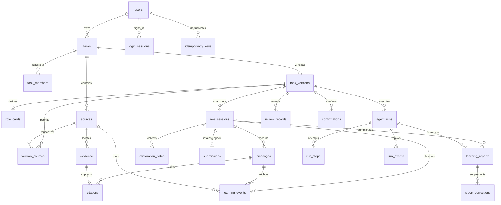

# 阶段一：数据库表设计

版本：1.1，2026-11-04。依据已确认的阶段一需求和最小实现方案，与[功能模块详细设计与实施计划](/Users/qxq/Documents/Codex/2026-11-02/ni-h/outputs/阶段一_功能模块详细设计与实施计划.md)、[接口文档](/Users/qxq/Documents/Codex/2026-11-02/ni-h/outputs/阶段一_接口文档.md)配套。本文提供建议数据模型和可执行的空库 DDL；不表示应用已经实现。

本版按已确认原型同步：新增学习事件、自动报告和学生更正；原 submissions 只读保留。上游需求文档及技术方案不改写。技术记录继续用于内部一致性、审计和排障，不直接显示在师生页面。

## 1. 设计范围与约定

采用 SQLite 保存业务状态、引用和运行记录，原始 PDF/TXT 存在本地受控目录。全文片段保存在 evidence，BM25 索引在内存中按版本快照重建。首版不增加向量数据库、消息队列或独立评测数据库。

- 共 23 张表，新增 learning_events、learning_reports、report_corrections。全部 UUID 由服务端生成并以 TEXT 保存；除关联表外以 id 为主键。DDL 中 TEXT 主键显式 NOT NULL。
- 对外 camelCase，对内 snake_case。时间使用服务端生成的固定格式 UTC 文本，例如 `2026-11-03T04:30:00.000Z`；同一格式才能稳定排序，客户端不能指定审计时间。
- JSON 列以 TEXT 保存，数据库检查 JSON 语法，Pydantic 负责对象形状、枚举、数组内引用和内容限制。JSON 内 UUID 不自动获得外键保障。
- version_no 是发布业务版本号；revision 是草稿内容版本；row_version 对应任务、笔记、学习事件及旧成果的乐观锁；learning_revision 是报告输入变化版本。它们不可混用。
- 每个连接开启 foreign_keys；建议本机持久化库使用 WAL、busy_timeout=5000，并保持事务短小。WAL 仍只有一个写事务，不能把模型调用、文件解析或等待用户确认放在写事务中。[DB1][DB3]
- 使用普通外键的默认 NO ACTION，不设置业务数据级联删除。归档任务、删除笔记采用逻辑状态；资料解除关联不删除原文件。
- 本设计以单后端进程为运行前提。后台执行队列和模型并发限额在进程内管理；数据库记录用于一致性和恢复判断。

## 2. 表清单及关系

| 表 | 职责 | 主要关系 |
| --- | --- | --- |
| users | 预置教师和学生 | 一个教师拥有多个 tasks。 |
| login_sessions | 登录令牌、CSRF 和有效期 | 多个会话属于一个 user。 |
| tasks | 任务所有者、状态、当前发布版本 | 一个 task 有多个 task_versions。 |
| task_members | 当前获准访问任务的学生名单 | task 与 student 的当前授权关系。 |
| task_versions | 教学意图、TaskBrief、问题链、字段来源与自动检查状态 | 每任务最多一个 draft。 |
| role_cards | 一个版本的正式角色卡 | 草稿为 0～1 个，发布时必须恰好 1 个。 |
| sources | 原始文件、解析状态与元数据 | 属于一个 task，可被同任务多个版本引用。 |
| version_sources | 版本允许使用的资料 | version 与 source 的多对多关联。 |
| evidence | 不可变的原文片段和位置 | 一个 source 对应多个片段。 |
| role_sessions | 教师预览或学生对话快照 | 固定 task、version、revision 和会话所有者。 |
| messages | 用户问题和助手输出块 | 一个 session 多条消息。 |
| citations | 已展示输出块到 Evidence 的引用 | 一块可引用多个片段。 |
| exploration_notes | 学生观点笔记与自主判断 | 属于 session，并指向原消息块。 |
| submissions | 旧版成果草稿及提交，只读保留 | 每个 student session 最多一份，新流程不再写入。 |
| learning_events | 来源打开、对回答的当前判断 | 同会话同资料/回答去重，不等同于技术 Run 事件。 |
| learning_reports | 自动学习报告、生成状态与不可变输入快照 | 一个会话多份 live，最多一份 final；重试复用报告行。 |
| report_corrections | 学生追加补充与更正 | 关联本人会话中的 ready 报告，不覆盖原文。 |
| agent_runs | 异步执行状态、预算和重试链 | 关联 version，可关联 session 或 source。 |
| run_steps | 每个步骤的尝试、结果和耗时 | 一个 Run 有多条步骤尝试记录。 |
| run_events | 可重放的 SSE 事件 | 每个 Run 独立递增序号。 |
| review_records | 核验、教师预览、评阅与业务审计 | 定位 version/revision、session、Run、message。 |
| confirmations | 人工确认的内容快照与消费状态 | 绑定用户、动作、版本及任务版本。 |
| idempotency_keys | 请求去重和结果恢复 | user + method + path + key 唯一。 |



ER 图展示主要关系；会话的内容以 snapshot_json 为准，不能通过联表读取后来被修改的草稿角色卡。

## 3. 字段语义与 JSON 结构

本节解释业务含义；第 5 节 DDL 给出全部字段类型、NULL、默认值、主外键和 CHECK。所有 `created_at/updated_at` 由服务层写入。

### 3.1 身份、任务和授权

| 表 | 字段 | 设计说明 |
| --- | --- | --- |
| users | username、display_name、role、password_hash、is_active | username 规范化后唯一；role=teacher/student；只保存 Argon2 密码哈希。停用不删除历史关联。 |
| login_sessions | token_hash、csrf_token、expires_at、revoked_at | 随机 Cookie 会话令牌只存哈希。CSRF token 本身不能用于登录，可保存随机原值，以供 `/auth/me` 返回；两个 token 都禁止写入日志。退出设置 revoked_at。 |
| tasks | owner_id、status、row_version、current_published_version_id、archived_at | status=active/archived；row_version 对外为 taskRevision；没有发布版本时指针为空。标题来自相应版本 brief_json。 |
| task_members | task_id、user_id、granted_by、created_at | 只保存当前名单；发布时覆盖集合。历史参与者从 role_sessions 查询，不能因撤销授权丢失教师报告。 |

用户角色、任务所有者和被授权学生身份由服务端校验。task_members 的普通外键只能证明用户存在，不能证明其 role=student。

### 3.2 版本、角色与资料

| 表 | 字段 | 设计说明 |
| --- | --- | --- |
| task_versions | version_no、revision、status、from_version_id | 同任务 version_no 唯一且递增；status=draft/published；复制版本记录来源，不复制学生数据。 |
| task_versions | teaching_intent、brief_json、question_plan_json | 一句话需求、TaskBrief、QuestionPlan。必需业务字段可以由默认值/生成补齐，发布前校验完整。 |
| task_versions | manual_fields_json、generation_meta_json | 服务端维护人工字段路径及 `{appliedRunId,appliedRevision,assumptions}`；模型不能标记自己为教师确认。 |
| task_versions | validation_status、validated_revision、preview_revision | stale/valid/invalid；valid 必须对应当前 revision；自动五类检查无 fail 才写 preview_revision，字段保留旧名；结果还须匹配当前内容哈希及 checkVersion。任何内容修改清空两个标记。 |
| task_versions | content_hash、published_at、published_by | 发布时保存规范内容 SHA-256 和发布者；草稿 content_hash 为空，预检实时计算。 |
| role_cards | id、version_id、card_json、edited_by | id 对应 RoleCard.roleId；card_json 保存接口 RoleCard 除 roleId 外的全部字段，序列化时补 id。每版本最多一行。 |
| sources | file_name、file_type、byte_size、sha256、storage_key | file_type=pdf/txt。storage_key 是服务端生成的相对存储标识，不能是用户上传路径或公开 URL；API 不返回此列。 |
| sources | status、page_count、total_lines、parser_version、parse_error_json、warnings_json | uploaded/parsing/ready/failed；PDF 用 page_count，TXT 用 total_lines；失败保留错误码与安全说明。 |
| version_sources | task_id、version_id、source_id | 复合外键阻止把另一个 task 的 Source 关联到当前版本；关联集合参与内容哈希。 |
| evidence | ordinal、text、page_no、paragraph_no、start_line、end_line、disputed | ordinal 是 source 内稳定顺序；PDF 保存页码和页内段落，TXT 保存首尾行及段落。disputed 只表示解析时已识别的争议标记，不能替代语义判断。 |

TaskBrief、RoleCard、QuestionPlan 的字段契约以接口文档第 2 节为准。RoleCard 的 `knownFacts[].evidenceIds`、`sourceIds` 等引用必须属于本版本资料；teacher 来源的陈述不因人工输入就自动成为可引用的资料事实。

Source ready 后原文件和 Evidence 不覆盖。事实“支持/反驳什么观点、可信状态如何”属于上下文判断，写入 review_records.result_json 中的 `evidenceAssessments`：`[{evidenceId,claim,relation,credibility,basis}]`。relation=supports/contradicts/context，credibility=unassessed/high/medium/low。不把 BM25 分数当可信度，也不因一次评阅改写原文。报告按版本和会话关联展示这些判断；没有评阅时明确为未评估。

### 3.3 会话、消息、引用和历史成果

| 表 | 字段 | 设计说明 |
| --- | --- | --- |
| role_sessions | owner_id、mode、status、version_revision | mode=preview/student；status=active/ended；学生每个版本最多一个会话，ended 不代表报告已成功生成。 |
| role_sessions | learning_revision、event_tracking_started_at | 学习过程变化版本；事件采集开始时间。新 student 会话从创建时采集，旧记录不能补造历史事件。 |
| role_sessions | snapshot_json | `{brief,roleCard,questionPlan,allowedSourceIds,contentHash}`；取创建时内容，包含 roleId。allowedSourceIds 为经确认的 roleCard.sourceIds，且必须是版本 ready 资料的子集。快照不可编辑；返回学生时只裁剪公开信息。 |
| role_sessions | summary_json、summary_through_seq、completed_turns | 摘要含已完成观点、未解决问题和下一步；summary_through_seq 标记覆盖到的完成消息；失败/取消回答不纳入摘要和 completed_turns。 |
| messages | seq、speaker、status、text、blocks_json、meta_json | seq 在 session 内唯一递增；user 为 complete 且 blocks=[]；assistant 随输出从 pending 到 partial，再到 complete，零块失败为 discarded。 |
| messages | run_id、supersedes_message_id | 用户问题 run_id 为空；助手消息对应唯一 Run；重试的助手指向被替代消息，原文保留。 |
| citations | message_id、block_index、evidence_id、quote | 一块一个片段只存一条；quote 必须是对应 Evidence 的原文摘录，不是模型自造文本。文件名和位置经 Evidence→Source 取得。 |
| exploration_notes | message_id、block_index、original_view、answer_type、evidence_ids_json | 从该学生已经看见的助手块生成只读快照；角色身份通过 session.snapshot_json 取得。 |
| exploration_notes | judgment、credibility、limitations、row_version、deleted_at | 只有学生判断、可信度和局限可编辑；均可选填；软删除后不计笔记数；会话 ended 后不可新增、修改或删除。 |
| submissions | status、content_json、row_version、submitted_at | status=draft/submitted；保持旧 content 原样，只读返回 LegacySubmission；本版不再要求学生填表或写此表。 |

Message.blocks_json 对应 AnswerBlock[]；meta_json 保存公开的 roleId、roleType、timeAnchor、followUpQuestions、phase、memorySummary。text 是 blocks 的拼接缓存，必须在同一个事务中更新，不能与块内容各自生成。

已取消但已展示的合格块仍可做笔记，必须显示“不完整”。supersedes_message_id 只是重试关联，不能隐藏已有笔记对应的原消息。学生可访问原文的依据为本人会话中已落库并可展示的 Citation，同时必须仍有任务成员权限。

### 3.4 学习事件、自动报告及更正

| 表 | 字段 | 设计说明 |
| --- | --- | --- |
| learning_events | session_id、event_type、source_id、message_id、value | source_open 只填 source_id；stance 只填完整助手 message_id/value，来自当前学生操作。 |
| learning_events | row_version、created_at、updated_at | 来源首次打开后重复请求不更新/不重复计数；判断改选按 row_version 更新，原始消息保持不变。 |
| learning_reports | session_id、report_no、kind、input_revision、input_hash | kind=live/final；快照版本取 role_sessions.learning_revision。唯一键防止同快照重复建报告；hash 对规范输入计算。 |
| learning_reports | input_snapshot_json | 固定 brief/角色、学生消息、已终结助手消息与引用、学习事件、收藏和 sourceTracking；不含运行中助手输出和隐藏提示。 |
| learning_reports | status、generation_run_id、error_json | queued/generating/ready/failed/superseded；指向本次尝试 Run。失败重试回 queued、清空当前 Run 指针，新 Run 保留所有旧尝试轨迹。 |
| learning_reports | content_json、generated_at | ready 时必须存在，内容为接口 ReportContent。计数由程序依据快照与 signals 算出；ready 后不可覆盖。 |
| report_corrections | session_id、report_id、author_id、text、created_at | 只追加；report 与 session 使用复合外键。服务端验证 ready 且 author 为学生 owner。不会改原报告正文或增加探究计数。 |

learning_revision 在学生消息接受、助手终态、有效学习事件和收藏变化、结束探究时递增；流式中间块不递增，教师回看、更正、报告生成不递增。只对 mode=student 安排学习报告。每轮终态或有效学习操作自动排队，最新未执行 live 可取代旧 queued live，旧行置 superseded；不删除已经 ready 的报告。

队列行和输入快照持久化到 learning_reports。每会话最多一个报告实际生成，chat/summary 另有独立互斥约束；全局容量仍由服务端控制。读 H09 不调用模型，页面在历史报告缺失时自动通过 H13 补齐。按 kind、input_revision/report_no 选择报告，不能只按完成时间排序。结束后最新目标始终是 final；可同时返回最近 ready live 供等待时阅读。

sourceTracking 根据 event_tracking_started_at 与会话创建时间得出：相同为 complete，晚于创建为 partial，NULL 为 unavailable。旧记录缺少采集时不补 0 或虚构点击；出现新操作后开始采集也只能标 partial。教师查看与系统预览不会写入 learning_events。

### 3.5 运行、轨迹、确认和幂等

| 表 | 字段 | 设计说明 |
| --- | --- | --- |
| agent_runs | kind、status、actor_id、task_id、version_id、version_revision | kind=parse_material/role_generate/role_validate/plan_generate/publish_preflight/chat/summary/learning_report；status=running/waiting_confirmation/completed/failed/cancelled。 |
| agent_runs | session_id、source_id、input_message_id、output_message_id、retry_of_run_id | chat/summary/learning_report 有 session；parse_material 有 source；chat 复用重试前的 input_message_id，但新建助手消息和 Run。 |
| agent_runs | step_count、max_steps、deadline_at、cancel_requested_at、terminal_reason | 每次工具/模型实际尝试先扣步骤；首次加两次修复/重试均计入预算。停止写块前再次检查取消及终态。 |
| agent_runs | execution_config_json、result_json、error_json | 配置保存模型标识、模型配置版本、Prompt 版本和参数，不保存密钥；角色生成候选、recommendationReason、coverage 和 candidateHash 保存在 result_json，结构见接口文档。 |
| run_steps | step_no、attempt、name、status、input_summary_json、output_summary_json、error_json | step_no 为逻辑步骤编号；attempt=1/2/3；只保留可解释结果和排障必要摘要，不存内部思维链。 |
| run_events | seq、event_type、payload_json | seq 从 1 递增，与 answer.block/message/citation 同事务写入；事件公开字段按 API 契约生成。 |
| review_records | kind、version_revision、session_id、run_id、message_id、block_index、actor_id | kind=role_validation/answer_check/preview_review/publish_preflight/evaluation/business_audit；系统核验 actor_id 可空。 |
| review_records | passed、result_json、issues_json | passed 可空；publish_preflight 保存五类自动结果、checkVersion、contentHash；preview_review 仅留旧记录。evaluation 保存教学评阅；business_audit 保存生成应用前快照、撤销引用、发布及恢复等动作和前后 revision/hash。 |
| confirmations | actor_id、action、version_revision、task_revision、payload_json、payload_hash、content_hash | action=publish_version/apply_role_candidate/archive_task/replace_plan；绑定当前用户与具体内容，不接受模型伪造确认。 |
| confirmations | expires_at、consumed_at | 默认有效 30 分钟；消费必须与业务写入同事务；不能在调用开始就提前标记消费。 |
| idempotency_keys | user_id、method、path、key、request_hash、status | 作用域唯一；请求哈希包括方法、规范路径、业务正文及影响语义的并发条件，文件请求使用文件 SHA-256；不包含 Cookie/CSRF。 |
| idempotency_keys | response_status、response_json、resource_id、created_at、expires_at | 保存响应封装的 data 和原状态码，重放时生成新的 requestId；resource_id 是非外键索引提示，不能用于绕过授权。至少保留 24 小时。 |

role_validation 的 result_json 保存有效性和问题链检查；answer_check 可保存 evidenceAssessments 和失败原因。被拦截而未展示的文本只能出现在受控摘要中；定位到 Run 和问题，不应把它伪装成已展示的消息块。

## 4. 约束分工

| 不变量 | 数据库负责 | 服务层事务负责 |
| --- | --- | --- |
| 每任务最多一个草稿 | draft 条件唯一索引。 | 复制来源是同任务 published；分配下一 version_no。 |
| 正式角色只有一个 | role_cards.version_id 唯一。 | 发布时必须存在、字段完整、角色/时间一致。 |
| 资料不得跨任务关联 | version_sources 两个复合外键。 | Source ready、草稿可写、角色引用在范围内。 |
| 会话不串任务版本 | role_sessions 复合外键。 | student 只能读 published；preview 绑定实际 revision。 |
| 每学生每版本一个会话 | student 条件唯一索引。 | owner 的 role、当前授权和任务状态。 |
| 会话并发 | chat/summary 共用 running 唯一索引；learning_report 单独一个。 | 报告读取固定快照，不阻塞学生对话；共享全局调用限额。 |
| 同一问题只完成一次 | completed chat 的 input_message_id 条件唯一索引。 | 重试仅允许最后一个失败问题；同事务计 completed_turns。 |
| 消息、Run 不跨会话 | input/output 以及 message.run 的复合外键。 | 用户/助手身份、Run kind 和输出归属正确。 |
| 引用不伪造 | evidence_id 外键、引用组合唯一。 | 片段属于当前快照、支持对应块、quote 来自原文。 |
| 确认只使用一次 | consumed_at 持久化。 | 条件更新 consumed_at IS NULL，并验证版本、哈希、期限、用户和动作。 |
| 发布后不可修改 | 发布标记、内容哈希、历史引用外键。 | 所有写入口拒绝 published，禁止修改其 RoleCard/资料关联；本 DDL 未用触发器自动冻结。 |
| 原文/报告/旧成果保留 | 状态、引用及报告快照唯一约束。 | ready 原文与报告不可覆盖，submissions 仅只读；结束后对话/笔记/事件只读，更正另行追加。 |
| 学习行为去重 | source_open/stance 两个条件唯一索引。 | 只允许本人已展示来源和完整助手回答；改选核对 row_version。 |
| 报告重试不重建学习 | 同快照同 kind 唯一、每会话 final 唯一。 | 同报告新建 Run，按当前 generation_run_id 回写；结束事务不等待模型。 |
| 更正不串报告会话 | report_id/session_id 复合外键。 | 验证学生 owner、当前授权和 ready 状态，正文只增不改。 |

条件唯一索引用于只约束指定状态的记录。[DB2] CHECK 仅约束当前一行，不证明状态迁移合法，也不替代权限检查。以下 DDL 故意不声称能够单独阻止全部业务越权；服务层必须集中实现并测试这些规则。

## 5. 可执行 SQLite DDL

适用于空库首次迁移。运行环境需支持 JSON 函数；启动时检查，不满足则阻止启动并提示使用项目锁定的运行环境。正式文件库在连接初始化中另行设置 WAL 和 busy_timeout，下面 SQL 可直接在内存数据库验证。升级已有库必须写迁移，不能把这段脚本反复执行当作升级。

```sql
PRAGMA foreign_keys = ON;
BEGIN;

CREATE TABLE users (
  id TEXT PRIMARY KEY NOT NULL,
  username TEXT NOT NULL UNIQUE,
  display_name TEXT NOT NULL,
  role TEXT NOT NULL CHECK (role IN ('teacher','student')),
  password_hash TEXT NOT NULL,
  is_active INTEGER NOT NULL DEFAULT 1 CHECK (is_active IN (0,1)),
  created_at TEXT NOT NULL,
  updated_at TEXT NOT NULL
);

CREATE TABLE login_sessions (
  id TEXT PRIMARY KEY NOT NULL,
  user_id TEXT NOT NULL REFERENCES users(id),
  token_hash TEXT NOT NULL UNIQUE,
  csrf_token TEXT NOT NULL,
  expires_at TEXT NOT NULL,
  revoked_at TEXT,
  created_at TEXT NOT NULL,
  CHECK (expires_at > created_at)
);

CREATE TABLE tasks (
  id TEXT PRIMARY KEY NOT NULL,
  owner_id TEXT NOT NULL REFERENCES users(id),
  status TEXT NOT NULL DEFAULT 'active' CHECK (status IN ('active','archived')),
  row_version INTEGER NOT NULL DEFAULT 1 CHECK (row_version > 0),
  current_published_version_id TEXT,
  archived_at TEXT,
  created_at TEXT NOT NULL,
  updated_at TEXT NOT NULL,
  CHECK ((status = 'active' AND archived_at IS NULL)
      OR (status = 'archived' AND archived_at IS NOT NULL)),
  FOREIGN KEY (id, current_published_version_id)
    REFERENCES task_versions(task_id, id) DEFERRABLE INITIALLY DEFERRED
);

CREATE TABLE task_members (
  task_id TEXT NOT NULL REFERENCES tasks(id),
  user_id TEXT NOT NULL REFERENCES users(id),
  granted_by TEXT NOT NULL REFERENCES users(id),
  created_at TEXT NOT NULL,
  PRIMARY KEY (task_id, user_id)
);

CREATE TABLE task_versions (
  id TEXT PRIMARY KEY NOT NULL,
  task_id TEXT NOT NULL REFERENCES tasks(id),
  version_no INTEGER NOT NULL CHECK (version_no > 0),
  revision INTEGER NOT NULL DEFAULT 1 CHECK (revision > 0),
  status TEXT NOT NULL DEFAULT 'draft' CHECK (status IN ('draft','published')),
  from_version_id TEXT REFERENCES task_versions(id),
  teaching_intent TEXT NOT NULL DEFAULT '',
  manual_fields_json TEXT NOT NULL DEFAULT '[]'
    CHECK (json_valid(manual_fields_json) AND json_type(manual_fields_json) = 'array'),
  generation_meta_json TEXT NOT NULL DEFAULT '{}'
    CHECK (json_valid(generation_meta_json) AND json_type(generation_meta_json) = 'object'),
  brief_json TEXT NOT NULL DEFAULT '{}' CHECK (json_valid(brief_json)),
  question_plan_json TEXT NOT NULL DEFAULT '[]' CHECK (json_valid(question_plan_json)),
  validation_status TEXT NOT NULL DEFAULT 'stale'
    CHECK (validation_status IN ('stale','valid','invalid')),
  validated_revision INTEGER,
  preview_revision INTEGER,
  content_hash TEXT,
  published_at TEXT,
  published_by TEXT REFERENCES users(id),
  created_at TEXT NOT NULL,
  updated_at TEXT NOT NULL,
  UNIQUE (task_id, version_no),
  UNIQUE (task_id, id),
  CHECK ((validation_status = 'valid' AND validated_revision IS NOT NULL
          AND validated_revision = revision)
      OR (validation_status IN ('stale','invalid') AND validated_revision IS NULL)),
  CHECK (preview_revision IS NULL OR preview_revision = revision),
  CHECK ((status = 'draft' AND published_at IS NULL AND published_by IS NULL
          AND content_hash IS NULL)
      OR (status = 'published' AND published_at IS NOT NULL AND published_by IS NOT NULL
          AND content_hash IS NOT NULL AND validation_status = 'valid'
          AND preview_revision IS NOT NULL AND preview_revision = revision))
);

CREATE TABLE role_cards (
  id TEXT PRIMARY KEY NOT NULL,
  version_id TEXT NOT NULL UNIQUE REFERENCES task_versions(id),
  card_json TEXT NOT NULL CHECK (json_valid(card_json)),
  edited_by TEXT NOT NULL REFERENCES users(id),
  created_at TEXT NOT NULL,
  updated_at TEXT NOT NULL
);

CREATE TABLE sources (
  id TEXT PRIMARY KEY NOT NULL,
  task_id TEXT NOT NULL REFERENCES tasks(id),
  uploaded_by TEXT NOT NULL REFERENCES users(id),
  file_name TEXT NOT NULL,
  file_type TEXT NOT NULL CHECK (file_type IN ('pdf','txt')),
  byte_size INTEGER NOT NULL CHECK (byte_size > 0),
  sha256 TEXT NOT NULL CHECK (length(sha256) = 64),
  storage_key TEXT NOT NULL UNIQUE,
  status TEXT NOT NULL DEFAULT 'uploaded'
    CHECK (status IN ('uploaded','parsing','ready','failed')),
  page_count INTEGER CHECK (page_count IS NULL OR page_count > 0),
  total_lines INTEGER CHECK (total_lines IS NULL OR total_lines > 0),
  parser_version TEXT,
  parse_error_json TEXT CHECK (parse_error_json IS NULL OR json_valid(parse_error_json)),
  warnings_json TEXT NOT NULL DEFAULT '[]' CHECK (json_valid(warnings_json)),
  created_at TEXT NOT NULL,
  updated_at TEXT NOT NULL,
  UNIQUE (task_id, id),
  CHECK ((status = 'failed' AND parse_error_json IS NOT NULL)
      OR (status <> 'failed' AND parse_error_json IS NULL)),
  CHECK (status <> 'ready' OR (parser_version IS NOT NULL AND
    ((file_type = 'pdf' AND page_count IS NOT NULL)
     OR (file_type = 'txt' AND total_lines IS NOT NULL))))
);

CREATE TABLE version_sources (
  task_id TEXT NOT NULL,
  version_id TEXT NOT NULL,
  source_id TEXT NOT NULL,
  created_at TEXT NOT NULL,
  PRIMARY KEY (version_id, source_id),
  FOREIGN KEY (task_id, version_id) REFERENCES task_versions(task_id, id),
  FOREIGN KEY (task_id, source_id) REFERENCES sources(task_id, id)
);

CREATE TABLE evidence (
  id TEXT PRIMARY KEY NOT NULL,
  source_id TEXT NOT NULL REFERENCES sources(id),
  ordinal INTEGER NOT NULL CHECK (ordinal > 0),
  text TEXT NOT NULL CHECK (length(trim(text)) > 0),
  page_no INTEGER CHECK (page_no IS NULL OR page_no > 0),
  paragraph_no INTEGER NOT NULL CHECK (paragraph_no > 0),
  start_line INTEGER,
  end_line INTEGER,
  disputed INTEGER NOT NULL DEFAULT 0 CHECK (disputed IN (0,1)),
  created_at TEXT NOT NULL,
  UNIQUE (source_id, ordinal),
  CHECK ((page_no IS NOT NULL AND start_line IS NULL AND end_line IS NULL)
      OR (page_no IS NULL AND start_line IS NOT NULL AND end_line IS NOT NULL
          AND start_line > 0 AND end_line >= start_line))
);

CREATE TABLE role_sessions (
  id TEXT PRIMARY KEY NOT NULL,
  task_id TEXT NOT NULL,
  version_id TEXT NOT NULL,
  version_revision INTEGER NOT NULL CHECK (version_revision > 0),
  owner_id TEXT NOT NULL REFERENCES users(id),
  mode TEXT NOT NULL CHECK (mode IN ('preview','student')),
  status TEXT NOT NULL DEFAULT 'active' CHECK (status IN ('active','ended')),
  snapshot_json TEXT NOT NULL CHECK (json_valid(snapshot_json)),
  summary_json TEXT NOT NULL DEFAULT '{}' CHECK (json_valid(summary_json)),
  summary_through_seq INTEGER NOT NULL DEFAULT 0 CHECK (summary_through_seq >= 0),
  completed_turns INTEGER NOT NULL DEFAULT 0 CHECK (completed_turns >= 0),
  learning_revision INTEGER NOT NULL DEFAULT 0 CHECK (learning_revision >= 0),
  event_tracking_started_at TEXT,
  ended_at TEXT,
  created_at TEXT NOT NULL,
  updated_at TEXT NOT NULL,
  FOREIGN KEY (task_id, version_id) REFERENCES task_versions(task_id, id),
  CHECK ((status = 'active' AND ended_at IS NULL)
      OR (status = 'ended' AND ended_at IS NOT NULL))
);

CREATE TABLE messages (
  id TEXT PRIMARY KEY NOT NULL,
  session_id TEXT NOT NULL REFERENCES role_sessions(id),
  seq INTEGER NOT NULL CHECK (seq > 0),
  speaker TEXT NOT NULL CHECK (speaker IN ('user','assistant')),
  status TEXT NOT NULL CHECK (status IN ('pending','partial','complete','discarded')),
  text TEXT NOT NULL DEFAULT '',
  blocks_json TEXT NOT NULL DEFAULT '[]' CHECK (json_valid(blocks_json)),
  meta_json TEXT NOT NULL DEFAULT '{}' CHECK (json_valid(meta_json)),
  run_id TEXT,
  supersedes_message_id TEXT,
  created_at TEXT NOT NULL,
  updated_at TEXT NOT NULL,
  UNIQUE (session_id, seq),
  UNIQUE (id, session_id),
  UNIQUE (run_id),
  FOREIGN KEY (run_id, session_id) REFERENCES agent_runs(id, session_id),
  FOREIGN KEY (supersedes_message_id, session_id) REFERENCES messages(id, session_id),
  CHECK ((speaker = 'user' AND run_id IS NULL AND status = 'complete'
          AND supersedes_message_id IS NULL)
      OR (speaker = 'assistant' AND run_id IS NOT NULL))
);

CREATE TABLE citations (
  id TEXT PRIMARY KEY NOT NULL,
  message_id TEXT NOT NULL REFERENCES messages(id),
  block_index INTEGER NOT NULL CHECK (block_index >= 0),
  evidence_id TEXT NOT NULL REFERENCES evidence(id),
  quote TEXT NOT NULL CHECK (length(trim(quote)) > 0),
  created_at TEXT NOT NULL,
  UNIQUE (message_id, block_index, evidence_id)
);

CREATE TABLE exploration_notes (
  id TEXT PRIMARY KEY NOT NULL,
  session_id TEXT NOT NULL REFERENCES role_sessions(id),
  message_id TEXT NOT NULL,
  block_index INTEGER NOT NULL CHECK (block_index >= 0),
  original_view TEXT NOT NULL,
  answer_type TEXT NOT NULL CHECK (answer_type IN ('fact','opinion','inference','unknown')),
  evidence_ids_json TEXT NOT NULL DEFAULT '[]' CHECK (json_valid(evidence_ids_json)),
  judgment TEXT NOT NULL DEFAULT '',
  credibility TEXT NOT NULL DEFAULT 'unassessed'
    CHECK (credibility IN ('unassessed','high','medium','low')),
  limitations TEXT NOT NULL DEFAULT '',
  row_version INTEGER NOT NULL DEFAULT 1 CHECK (row_version > 0),
  deleted_at TEXT,
  created_at TEXT NOT NULL,
  updated_at TEXT NOT NULL,
  FOREIGN KEY (message_id, session_id) REFERENCES messages(id, session_id)
);

CREATE TABLE submissions (
  id TEXT PRIMARY KEY NOT NULL,
  session_id TEXT NOT NULL UNIQUE REFERENCES role_sessions(id),
  status TEXT NOT NULL DEFAULT 'draft' CHECK (status IN ('draft','submitted')),
  content_json TEXT NOT NULL DEFAULT '{}' CHECK (json_valid(content_json)),
  row_version INTEGER NOT NULL DEFAULT 1 CHECK (row_version > 0),
  submitted_at TEXT,
  created_at TEXT NOT NULL,
  updated_at TEXT NOT NULL,
  CHECK ((status = 'draft' AND submitted_at IS NULL)
      OR (status = 'submitted' AND submitted_at IS NOT NULL))
);

CREATE TABLE learning_events (
  id TEXT PRIMARY KEY NOT NULL,
  session_id TEXT NOT NULL REFERENCES role_sessions(id),
  event_type TEXT NOT NULL CHECK (event_type IN ('source_open','stance')),
  source_id TEXT REFERENCES sources(id),
  message_id TEXT,
  value TEXT,
  row_version INTEGER NOT NULL DEFAULT 1 CHECK (row_version > 0),
  created_at TEXT NOT NULL,
  updated_at TEXT NOT NULL,
  FOREIGN KEY (message_id, session_id) REFERENCES messages(id, session_id),
  CHECK ((event_type = 'source_open' AND source_id IS NOT NULL
          AND message_id IS NULL AND value IS NULL)
      OR (event_type = 'stance' AND source_id IS NULL AND message_id IS NOT NULL
          AND value IS NOT NULL
          AND value IN ('need_more_evidence','agree_for_now','alternative_explanation')))
);

CREATE TABLE learning_reports (
  id TEXT PRIMARY KEY NOT NULL,
  session_id TEXT NOT NULL REFERENCES role_sessions(id),
  report_no INTEGER NOT NULL CHECK (report_no > 0),
  kind TEXT NOT NULL CHECK (kind IN ('live','final')),
  status TEXT NOT NULL DEFAULT 'queued'
    CHECK (status IN ('queued','generating','ready','failed','superseded')),
  input_revision INTEGER NOT NULL CHECK (input_revision > 0),
  input_hash TEXT NOT NULL CHECK (length(input_hash) = 64),
  input_snapshot_json TEXT NOT NULL
    CHECK (json_valid(input_snapshot_json) AND json_type(input_snapshot_json) = 'object'),
  generation_run_id TEXT,
  content_json TEXT CHECK (content_json IS NULL
    OR (json_valid(content_json) AND json_type(content_json) = 'object')),
  error_json TEXT CHECK (error_json IS NULL OR json_valid(error_json)),
  generated_at TEXT,
  created_at TEXT NOT NULL,
  updated_at TEXT NOT NULL,
  UNIQUE (id, session_id),
  UNIQUE (session_id, report_no),
  UNIQUE (session_id, kind, input_revision),
  FOREIGN KEY (generation_run_id, session_id) REFERENCES agent_runs(id, session_id),
  CHECK ((status = 'ready' AND content_json IS NOT NULL AND generated_at IS NOT NULL)
      OR (status <> 'ready' AND content_json IS NULL AND generated_at IS NULL)),
  CHECK ((status = 'failed' AND error_json IS NOT NULL)
      OR (status <> 'failed' AND error_json IS NULL)),
  CHECK ((status IN ('queued','superseded') AND generation_run_id IS NULL)
      OR (status IN ('generating','ready','failed') AND generation_run_id IS NOT NULL))
);

CREATE TABLE report_corrections (
  id TEXT PRIMARY KEY NOT NULL,
  session_id TEXT NOT NULL REFERENCES role_sessions(id),
  report_id TEXT NOT NULL,
  author_id TEXT NOT NULL REFERENCES users(id),
  text TEXT NOT NULL CHECK (length(trim(text)) BETWEEN 1 AND 2000),
  created_at TEXT NOT NULL,
  FOREIGN KEY (report_id, session_id) REFERENCES learning_reports(id, session_id)
);

CREATE TABLE agent_runs (
  id TEXT PRIMARY KEY NOT NULL,
  actor_id TEXT NOT NULL REFERENCES users(id),
  task_id TEXT NOT NULL,
  version_id TEXT NOT NULL,
  version_revision INTEGER NOT NULL CHECK (version_revision > 0),
  kind TEXT NOT NULL CHECK (kind IN ('parse_material','role_generate','role_validate','plan_generate','publish_preflight','chat','summary','learning_report')),
  status TEXT NOT NULL DEFAULT 'running'
    CHECK (status IN ('running','waiting_confirmation','completed','failed','cancelled')),
  session_id TEXT REFERENCES role_sessions(id),
  source_id TEXT REFERENCES sources(id),
  input_message_id TEXT,
  output_message_id TEXT,
  retry_of_run_id TEXT REFERENCES agent_runs(id),
  step_count INTEGER NOT NULL DEFAULT 0 CHECK (step_count >= 0),
  max_steps INTEGER NOT NULL DEFAULT 20 CHECK (max_steps > 0),
  deadline_at TEXT NOT NULL,
  cancel_requested_at TEXT,
  terminal_reason TEXT,
  execution_config_json TEXT NOT NULL DEFAULT '{}' CHECK (json_valid(execution_config_json)),
  result_json TEXT CHECK (result_json IS NULL OR json_valid(result_json)),
  error_json TEXT CHECK (error_json IS NULL OR json_valid(error_json)),
  created_at TEXT NOT NULL,
  finished_at TEXT,
  UNIQUE (id, session_id),
  FOREIGN KEY (task_id, version_id) REFERENCES task_versions(task_id, id),
  FOREIGN KEY (input_message_id, session_id) REFERENCES messages(id, session_id),
  FOREIGN KEY (output_message_id, session_id) REFERENCES messages(id, session_id),
  CHECK (step_count <= max_steps),
  CHECK (deadline_at > created_at),
  CHECK ((kind IN ('chat','summary','learning_report') AND session_id IS NOT NULL AND source_id IS NULL)
      OR (kind = 'parse_material' AND source_id IS NOT NULL AND session_id IS NULL)
      OR (kind IN ('role_generate','role_validate','plan_generate','publish_preflight') AND session_id IS NULL AND source_id IS NULL)),
  CHECK ((kind = 'chat' AND input_message_id IS NOT NULL)
      OR (kind <> 'chat' AND input_message_id IS NULL AND output_message_id IS NULL
          AND retry_of_run_id IS NULL)),
  CHECK (status <> 'waiting_confirmation' OR (kind = 'role_generate' AND result_json IS NOT NULL)),
  CHECK ((status IN ('running','waiting_confirmation') AND finished_at IS NULL)
      OR (status IN ('completed','failed','cancelled') AND finished_at IS NOT NULL))
);

CREATE TABLE run_steps (
  id TEXT PRIMARY KEY NOT NULL,
  run_id TEXT NOT NULL REFERENCES agent_runs(id),
  step_no INTEGER NOT NULL CHECK (step_no > 0),
  attempt INTEGER NOT NULL CHECK (attempt BETWEEN 1 AND 3),
  name TEXT NOT NULL,
  status TEXT NOT NULL CHECK (status IN ('running','completed','failed','cancelled')),
  input_summary_json TEXT NOT NULL DEFAULT '{}' CHECK (json_valid(input_summary_json)),
  output_summary_json TEXT CHECK (output_summary_json IS NULL OR json_valid(output_summary_json)),
  error_json TEXT CHECK (error_json IS NULL OR json_valid(error_json)),
  started_at TEXT NOT NULL,
  finished_at TEXT,
  UNIQUE (run_id, step_no, attempt),
  CHECK ((status = 'running' AND finished_at IS NULL)
      OR (status <> 'running' AND finished_at IS NOT NULL))
);

CREATE TABLE run_events (
  id TEXT PRIMARY KEY NOT NULL,
  run_id TEXT NOT NULL REFERENCES agent_runs(id),
  seq INTEGER NOT NULL CHECK (seq > 0),
  event_type TEXT NOT NULL CHECK (event_type IN
    ('run.started','run.progress','answer.block','answer.meta','run.waiting_confirmation',
     'run.completed','run.failed','run.cancelled')),
  payload_json TEXT NOT NULL CHECK (json_valid(payload_json)),
  created_at TEXT NOT NULL,
  UNIQUE (run_id, seq)
);

CREATE TABLE review_records (
  id TEXT PRIMARY KEY NOT NULL,
  task_id TEXT NOT NULL,
  version_id TEXT NOT NULL,
  version_revision INTEGER NOT NULL CHECK (version_revision > 0),
  kind TEXT NOT NULL CHECK (kind IN
    ('role_validation','answer_check','preview_review','publish_preflight','evaluation','business_audit')),
  session_id TEXT REFERENCES role_sessions(id),
  run_id TEXT REFERENCES agent_runs(id),
  message_id TEXT,
  block_index INTEGER CHECK (block_index IS NULL OR block_index >= 0),
  actor_id TEXT REFERENCES users(id),
  passed INTEGER CHECK (passed IS NULL OR passed IN (0,1)),
  result_json TEXT NOT NULL DEFAULT '{}' CHECK (json_valid(result_json)),
  issues_json TEXT NOT NULL DEFAULT '[]' CHECK (json_valid(issues_json)),
  created_at TEXT NOT NULL,
  FOREIGN KEY (task_id, version_id) REFERENCES task_versions(task_id, id),
  FOREIGN KEY (message_id, session_id) REFERENCES messages(id, session_id),
  CHECK (message_id IS NULL OR session_id IS NOT NULL),
  CHECK (block_index IS NULL OR message_id IS NOT NULL)
);

CREATE TABLE confirmations (
  id TEXT PRIMARY KEY NOT NULL,
  task_id TEXT NOT NULL,
  version_id TEXT NOT NULL,
  version_revision INTEGER NOT NULL CHECK (version_revision > 0),
  task_revision INTEGER NOT NULL CHECK (task_revision > 0),
  actor_id TEXT NOT NULL REFERENCES users(id),
  action TEXT NOT NULL CHECK (action IN ('publish_version','apply_role_candidate','archive_task','replace_plan')),
  payload_json TEXT NOT NULL CHECK (json_valid(payload_json)),
  payload_hash TEXT NOT NULL CHECK (length(payload_hash) = 64),
  content_hash TEXT NOT NULL CHECK (length(content_hash) = 64),
  expires_at TEXT NOT NULL,
  consumed_at TEXT,
  created_at TEXT NOT NULL,
  FOREIGN KEY (task_id, version_id) REFERENCES task_versions(task_id, id),
  CHECK (expires_at > created_at),
  CHECK (consumed_at IS NULL OR (consumed_at >= created_at AND consumed_at < expires_at))
);

CREATE TABLE idempotency_keys (
  id TEXT PRIMARY KEY NOT NULL,
  user_id TEXT NOT NULL REFERENCES users(id),
  method TEXT NOT NULL,
  path TEXT NOT NULL,
  key TEXT NOT NULL CHECK (length(key) BETWEEN 1 AND 128),
  request_hash TEXT NOT NULL CHECK (length(request_hash) = 64),
  status TEXT NOT NULL CHECK (status IN ('in_progress','completed')),
  response_status INTEGER CHECK (response_status IS NULL OR response_status BETWEEN 200 AND 599),
  response_json TEXT CHECK (response_json IS NULL OR json_valid(response_json)),
  resource_id TEXT,
  created_at TEXT NOT NULL,
  expires_at TEXT NOT NULL,
  UNIQUE (user_id, method, path, key),
  CHECK (expires_at > created_at),
  CHECK ((status = 'in_progress' AND response_status IS NULL AND response_json IS NULL)
      OR (status = 'completed' AND response_status IS NOT NULL AND response_json IS NOT NULL))
);

CREATE UNIQUE INDEX uq_one_draft_per_task ON task_versions(task_id) WHERE status = 'draft';
CREATE UNIQUE INDEX uq_student_session ON role_sessions(owner_id, version_id) WHERE mode = 'student';
CREATE UNIQUE INDEX uq_running_session ON agent_runs(session_id)
  WHERE status = 'running' AND kind IN ('chat','summary');
CREATE UNIQUE INDEX uq_running_report ON agent_runs(session_id)
  WHERE status = 'running' AND kind = 'learning_report';
CREATE UNIQUE INDEX uq_running_version_workflow ON agent_runs(version_id, version_revision, kind)
  WHERE status = 'running' AND kind IN ('plan_generate','publish_preflight','role_validate');
CREATE UNIQUE INDEX uq_source_open_event ON learning_events(session_id, source_id)
  WHERE event_type = 'source_open';
CREATE UNIQUE INDEX uq_stance_event ON learning_events(session_id, message_id)
  WHERE event_type = 'stance';
CREATE UNIQUE INDEX uq_final_learning_report ON learning_reports(session_id) WHERE kind = 'final';
CREATE UNIQUE INDEX uq_completed_chat_question ON agent_runs(input_message_id)
  WHERE kind = 'chat' AND status = 'completed';
CREATE UNIQUE INDEX uq_source_parsing_run ON agent_runs(source_id)
  WHERE kind = 'parse_material' AND status = 'running';
CREATE INDEX ix_login_user_expiry ON login_sessions(user_id, expires_at);
CREATE INDEX ix_tasks_owner_list ON tasks(owner_id, status, created_at, id);
CREATE INDEX ix_members_user ON task_members(user_id, task_id);
CREATE INDEX ix_sources_task_list ON sources(task_id, created_at, id);
CREATE INDEX ix_version_sources_source ON version_sources(source_id);
CREATE INDEX ix_sessions_task_list ON role_sessions(task_id, mode, created_at, id);
CREATE INDEX ix_sessions_version ON role_sessions(version_id);
CREATE INDEX ix_citations_evidence ON citations(evidence_id);
CREATE INDEX ix_notes_session_list ON exploration_notes(session_id, created_at, id) WHERE deleted_at IS NULL;
CREATE INDEX ix_runs_task_list ON agent_runs(task_id, created_at, id);
CREATE INDEX ix_runs_actor_status ON agent_runs(actor_id, status);
CREATE INDEX ix_runs_version ON agent_runs(version_id, version_revision);
CREATE INDEX ix_reviews_session_list ON review_records(session_id, created_at, id);
CREATE INDEX ix_reviews_version_kind ON review_records(version_id, version_revision, kind);
CREATE INDEX ix_confirmations_expiry ON confirmations(expires_at);
CREATE INDEX ix_idempotency_expiry ON idempotency_keys(expires_at);
CREATE INDEX ix_learning_events_session ON learning_events(session_id, event_type, updated_at);
CREATE INDEX ix_learning_reports_latest ON learning_reports(session_id, kind, input_revision DESC);
CREATE INDEX ix_learning_reports_queue ON learning_reports(status, created_at, id);
CREATE INDEX ix_report_corrections_session ON report_corrections(session_id, created_at, id);

PRAGMA user_version = 2;
COMMIT;
```

## 6. 必须实现的事务边界

### 6.1 草稿修改、异步解析与校验

所有草稿写入在一个短事务中检查 owner、task.status 和 `status='draft' AND revision=:expected`。更新内容时 revision+1、validation_status=stale、validated_revision=NULL、preview_revision=NULL，同时记录 business_audit。手工保存若已能确定角色与简报冲突，可设置 invalid，仍保留待修正内容。

上传先完成受限文件暂存和哈希，再以同一事务创建 Source、version_sources、parse Run、run.started、幂等响应并增加 draft revision。解析在事务外进行；成功事务一次性插入全部 Evidence、更新 Source=ready、增加仍关联该 Source 的 draft revision 并失效校验，最后终结 Run。失败不留下部分 Evidence，Source=failed。取消解析也将 Source=failed，错误码说明取消，可重新上传。解关联后解析完成不重新绑定资料。

角色/完整方案生成、校验及自动预检完成时比较启动 revision；不同则 Run=failed/STALE_REVISION，不覆盖新内容。预检通过记录须含当前 contentHash/checkVersion 和五类结果，写 preview_revision 前再次验证；GET 准备状态不创建 Run。资料解析只依赖不可变文件，允许教师同时改其他字段。ready 资料必须至少有一个可用片段。

### 6.2 方案生成、候选应用、撤销与发布

B07 保存 teaching_intent 和手工字段时同步维护 manual_fields_json；默认学科年级及 AI 填充不能伪装为人工输入。plan_generate 在事务外生成，只允许修改生成字段或本次 replace_plan 允许替换的人工字段；显式学科/年级、未授权人工字段及资料关联保留。

应用完整方案事务检查 owner、draft revision、taskRevision、资料集合及必要确认，在 business_audit.result_json 写 action=apply_plan、runId、beforeSnapshot（brief、角色、问题链、人工字段、原 generationMeta）和 appliedRevision；随后保存新方案、递增 revision、更新 generation_meta_json、清空通过标记、消费 replace_plan 确认并终结 Run。任何失败全回滚，不丢生成前内容。

撤销只允许该次 appliedRevision 仍等于当前 draft revision、没有对应 undo_plan 审计且未发布。恢复 beforeSnapshot 内容，保留教学意图及资料，增加 revision、清空通过标记，追加 undo_plan 审计引用原 Run。不得回退 revision 或覆盖之后的人工修改。

规范内容哈希包含 TaskBrief、RoleCard、QuestionPlan、排序后的 Source ID 及文件 SHA-256/解析版本；不包含 updated_at、验证状态、预览标记等工作流字段。发布名单另存 confirmation.payload_json 并排序去重计算 payload_hash。生成候选哈希只对服务端规范化的候选计算。replace_plan 的 content_hash 对 `{versionId,revision,taskRevision,intentHash,overwrittenFields,baseContentHash}` 规范化计算，绑定本次意图、替换范围和原草稿；不能复用于另一次改写。

应用候选事务检查候选 Run=waiting_confirmation、当前 revision/taskRevision、candidateHash、Confirmation.actor/action/content/期限，然后消费确认、替换 RoleCard/问题链、增加 revision、使旧检查失效、Run=completed、写事件和幂等响应。apply_role_candidate 的 content_hash 对 `{versionId,revision,runId,candidateHash}` 规范化计算；正式角色已有 ID 时保留，无角色时由服务端分配。事务回滚则确认仍未消费。

发布短事务重新读取版本和 taskRevision，重验字段、资料、当前 revision/hash/checkVersion 的已完成自动预检及确认名单。模型探测在事务外完成，不能在发布事务中等待模型。随后：消费确认 → 版本 published → 写 published_by/at/hash → 更新当前发布指针 → 覆盖 task_members → task.row_version+1 → 写审计与幂等响应。被移除学生的活跃 Run 同事务写 cancel_requested_at，提交后通知内存任务取消；之后所有写块均重新校验授权。

archive_task 的确认内容哈希为 `{taskId,taskRevision}`，版本只是定位上下文；新建或编辑草稿不改变 taskRevision 时不应使该归档确认失效。归档事务检查任务版本、消费确认、设置 archived、row_version+1，并请求取消任务全部活跃 Run。教师保留只读回查权限。恢复事务核对 owner/expectedTaskRevision，设 active、清空 archived_at、递增 row_version 并记 restore_task 审计；保留原授权名单与版本，不重启任何 Run。

### 6.3 对话、引用、完成、取消

1. 开始：检查任务、授权、会话状态/轮次/截止时间和运行容量；分配会话 seq，依次插入用户 Message（run_id 为空）、chat Run（input 指向用户）、助手占位 Message（run_id 指向 Run）、回填 output_message_id、保存 started 事件及幂等响应，student 会话递增 learning_revision，提交后注册执行任务。不能先插入引用尚不存在 Run 的助手消息。
2. 每个合格块：核对 Run=running、未取消、未超时、授权仍有效，写 blocks_json/text/status、Citation、answer_check、RunEvent，提交成功后才发送 SSE。
3. 完成：同事务将助手 complete、Run completed、completed_turns+1、合格摘要/元信息和 completed 事件落库。student 会话递增 learning_revision 并固定输入、安排 live 报告；completed chat 唯一索引防止同一问题再次成功。
4. 取消：短事务先写 cancel_requested_at；执行器终止网络流/子进程后，在终态事务设 cancelled，有块助手保留 partial、无块设 discarded，并写 cancelled 事件。完成事务必须检查 cancel_requested_at IS NULL；完成先提交则不再改状态，取消请求先提交则完成分支不得再把 Run 标为 completed。失败/取消终态同样递增 student 学习版本并安排报告，保留学生表达及带未完成标识的已展示内容，不增加 completed_turns。
5. 重试：验证最后一个失败问题及其最新一次 Run，插入新 Run 和助手消息，保留原用户问题，supersedes 指向上一次助手。已经被重试的旧 Run 不能再分叉创建新重试。原 Run 永不重新变 running，不重复插用户问题。

Run 和消息的外键引用同一 session，不代表 Run 自动属于该 session 的版本；服务层仍需比对 version_id、version_revision 和 actor。assistant 与 output_message_id 的双向一致也必须校验。

### 6.4 可选收藏、学习事件与结束

笔记创建从已展示块取原文/类型/引用，补充字段可空；写操作校验 student owner、成员权限、active 状态和 row_version。新增、编辑、软删除后递增 learning_revision 并安排 live 报告，ended 后只读。旧 submissions 不再接受写入。

source_open 在原文成功展示后由客户端提交，服务端验证本会话 Citation、当前成员及任务状态；同 session/source 已有则返回原记录，不递增学习版本。stance 验证完整非开场助手消息；首次 expectedRowVersion=0，改选需匹配已有 row_version，更新后版本加一。只在实际值变化时递增 learning_revision 并排队；同值重发返回当前记录。

F06 在事务内重查学生身份/当前成员资格/至少一条学生消息/没有 running chat 或 summary，设 ended 与 ended_at、learning_revision+1、创建 final queued 报告及固定输入快照、把旧 queued live 标 superseded，并保存幂等响应。任一写失败整体回滚；报告模型调用不在这个事务中。重复结束返回已有 final，不重复递增学习版本；preview 仅结束，不创建报告。

### 6.5 自动报告生成、失败与更正

1. 排队：输入快照包括学生表达、已终结助手消息/引用、当前来源/判断事件、收藏、任务角色和采集覆盖；在同一短事务读取并计算 input_hash，分配 report_no。唯一键保证同 session/kind/input_revision 一份。无学生表达时仅返回空状态，不调用模型。
2. 调度：持久化 queued 行是待办依据，进程启动后恢复；只选最新 live 或 final，旧 queued live 置 superseded。取得容量后同事务创建 learning_report Run（result/执行配置绑定 reportId）、报告设 generating/generation_run_id、写 started 事件。每会话报告串行，可与 chat 并行；服务层控制全局模型并发最多两个、报告最多一个，优先交互。
3. 完成：使用固定输入调用既有模型并校验 ReportContent 的字段、逐字摘录、消息归属、引用与语义依据。写回只在报告仍 generating 且 generation_run_id 等于本 Run 时执行，设 ready、content_json、generated_at，并终结 Run/事件。ready 结果不可重写；旧报告晚到只保存自身，不成为新 final。
4. 失败/取消：同事务设报告 failed/error_json、Run failed或cancelled、写终态事件。报告错误不会重开会话或删除原话。注册失败及 PROCESS_INTERRUPTED 也必须配套结束报告状态，不能留下永久 generating。
5. 重试：授权有效且报告 failed 时设 queued、清空 generation_run_id/error_json，保留输入快照与 report_no。新尝试创建新 Run，旧 Run/steps 留存；同一次并发重试只排队一次。过期 live 不重试，改请求最新 live。结束后的 final 仍可重试。
6. 更正：H10 验证作者为 session owner、当前任务权限及 report=ready，追加 report_corrections 和幂等结果。active/ended 均允许；不改原消息/报告/学习版本和统计。教师可读不能代写学生更正。

### 6.6 幂等、统计快照与导出

幂等先认证/鉴权，再查 key；已完成且 request_hash 相同先于 If-Match 重放，否则成功后的重放会误判冲突。新请求在业务短事务插入 in_progress、执行业务、保存响应并 completed；失败全回滚，不锁事务等待模型。异步响应缓存的是创建 Run/报告的 202，当前状态通过 GET 读取。唯一冲突后相同请求返回原响应，不同请求返回 IDEMPOTENCY_CONFLICT。

I01 读取完整授权范围的 student 会话、当前事件、最新 ready 报告及更正，使用短读事务形成统计快照和 aggregateToken；只对列表分页。确定性计数来自原始消息/事件，语义计数来自所选报告 signals；未知项为 null，附 ready/current/来源采集覆盖数。旧 submitted 成果可计完成报告但不虚构 signals，教师查看来源不计学生行为。

I04/I05 在短读事务重新计算范围 token；变化则 REPORT_CHANGED，要求刷新报告。生成导出使用已读快照、在事务外渲染转义 HTML，不调用模型，不建立导出数据表，不混入其他任务、技术日志或令牌。

## 7. 查询、恢复与数据留存

| 场景 | 查询依据及注意事项 |
| --- | --- |
| 学生任务列表 | task_members JOIN tasks；仅 active 且有 published 指针。 |
| 学生读消息、Run、证据和文件 | 校验 session.owner_id、当前 task_members 和 task.status；证据/原文还须存在该学生已展示消息对应的 Citation。不能仅凭 sourceId 放行。 |
| 教师报告 | 仅 owner，按 latest/all/version 筛选 student 会话；消息/事件确定性统计，ready 报告提供语义标签，附覆盖率。包括历史撤权学生，排除 preview。 |
| 学习报告 | ended 优先 final；无可用 final 时可另返回最近 ready live；按输入版本选结果，不能按完成时间覆盖。更正按 session 追加展示。 |
| 原文定位 | citations→evidence→sources；PDF 页码或 TXT 行号全部来自已解析元数据。 |
| SSE 重放 | run_events 按 run_id 和 seq>afterSeq 升序读取，每批和心跳前重查授权；撤权后关闭连接。断线重连不启动新执行。 |
| 启动恢复 | 将遗留 running Run/step 标失败，助手有块 partial、无块 discarded，解析 Source 设 failed；关联 generating 报告设 failed，保留 queued 报告供调度。写 PROCESS_INTERRUPTED；旧运行不自动重放。 |

启动恢复只处理确属上一次进程的记录，完成恢复后再接收请求；不把多个后端进程同时运行作为首版支持方式。

备份需覆盖数据库和受控资料目录。最小操作流程为停止新写入、等待或取消运行、关闭数据库连接，再复制完整数据目录并做恢复校验；使用 WAL 时不能在服务持续写入时只拷贝主 `.db` 文件。[DB3] 不把密钥写入备份目录。还原后检查每个 storage_key 对应文件及 sha256，并执行 foreign_key_check。

归档不自动清理原文、事件、确认或学生成果。首版不提供批量物理删除接口。过期登录会话和超过保留窗口的幂等缓存可以定期清理；未消费但已过期的确认保留作审计，不当作授权。用户内容的实际留存期限由项目部署方确定，本文不擅自设定自动删除时间。

使用 `PRAGMA user_version` 记录首版迁移号；后续迁移同步维护 JSON Schema 与数据库列。JSON 增删字段必须给出旧记录读法或转换步骤，不能把已有快照按新默认值静默改写。升级后重新做外键、引用定位、旧版本会话和幂等回放验证。

## 8. v1 数据兼容与迁移

此处 DDL 只用于空库创建，user_version=2；不得把它直接重跑到旧库。旧库升级需专用事务迁移脚本，不能直接删除旧表或用新默认值覆盖已有快照。正式迁移脚本尚未实现，应在 P0/T01 编写并验收。

1. 停写并按第 7 节备份数据库及资料，检查 user_version=1、外键和完整性。原 submissions、消息、引用、角色及发布版本逐行保留。
2. task_versions 增加 teaching_intent、manual_fields_json、generation_meta_json；来源未知的旧编辑字段按人工内容保护。draft 清空旧通过标记并标 stale；published 仍保留原验证/确认历史，不能追溯性改变已发布内容。
3. role_sessions 增加 learning_revision 和 event_tracking_started_at；有学生消息的旧会话学习版本初始化为 1，否则为 0。旧记录采集开始时间为 NULL，不补造 source_open/stance；后续真实交互才记录并标 partial。
4. 建三个新表及索引。扩展 agent_runs.kind、review_records.kind、confirmations.action 的 CHECK，按 SQLite 迁移流程重建相关表和索引并复制全部旧列。保留 ID 和所有关联；不要直接编辑 sqlite_schema。互相引用表的重建须在离线迁移中统一处理，结束前执行 foreign_key_check。
5. 旧 submissions 原样只读；旧长表写接口停用，不自动拆分、改写或宣称原成果由 AI 生成。缺少自动报告的旧会话可在授权页面自动调用 H13，输入仍只取已有原话；无原话时仅展示旧成果和采集缺失状态。
6. 已结束会话维持只读，允许为 ready 报告追加更正；历史 draft 成果也保留只读，不以它是否提交阻止阅读。
7. 校验表行数、哈希/快照、旧会话引用、授权与幂等回放后再设 user_version=2、恢复服务。CHECK/外键成功不代表完成业务授权验收；迁移失败整体回滚并保留备份。

## 9. 数据层验收清单

| 范围 | 验证内容 |
| --- | --- |
| 建库 | 空库执行全部 DDL 成功，23 张表；foreign_key_check 无结果，integrity_check=ok。 |
| 唯一约束 | 重复 draft/学生会话/chat 运行、重复报告运行、重复来源/判断事件、同快照重复报告及第二份 final 均拒绝。 |
| 关联范围 | 跨任务版本资料、跨任务会话版本、跨会话消息与笔记、跨会话 Run 输入被外键拒绝。 |
| 状态/数据形状 | 非法角色类型、非法枚举、坏 JSON、无位置证据、超步骤预算、缺完成时间被拒绝。 |
| 事务 | 发布失败不消费确认；块失败不产生孤立事件；结束与 final 排队同事务；模型失败不回滚已结束的学习。 |
| 自动报告 | chat 与 report 可并行，report 内串行；快照不可变、更正不串会话，失败重试保留原话与旧 Run。 |
| 兼容 | submissions 只读、历史采集缺失不补造、旧记录与来源哈希不变；迁移脚本须另验收。 |
| 服务层必测 | 发布冻结、ready 原文冻结、数组内证据权限、最后问题重试、撤权后的 SSE/文件读取、取消竞争、版本变更后旧确认拒绝。 |

DDL 验证只能证明数据库层的已声明约束与事务样例；权限、模型语义核验、文件定位 UI 和完整业务流程需实施后按前两份文档联调验收。

本版验证结果（2026-11-04）：SQLite 3.54.1 内存库成功创建 23 张表；69 项建库、约束及事务检查通过，foreign_key_check 无结果、integrity_check=ok。三份 Markdown 的围栏、表格列数和本地链接检查通过。验证覆盖既有版本/权限关联约束以及新增事件去重、报告并发、快照唯一、更正关联、结束排队回滚和报告失败保留结束状态。

现有 work/verify_design_contracts.py 保持原样，针对 v1.0 的 20 表；本轮在内存中将预期表集合适配为 23 表，复用 38 项基础用例并补充 31 项。检查没有连接业务库、执行实际旧库迁移或调用模型，不代表尚未实施的服务端授权、报告语义和应用端到端验收。

## 10. 技术依据

以下仅用于核对 SQLite 机制；具体业务表和事务划分为本项目设计建议。核对日期：2026-11-03。

- [DB1] SQLite 官方文档《SQLite Foreign Key Support》，`https://www.sqlite.org/foreignkeys.html`。
- [DB2] SQLite 官方文档《Partial Indexes》，`https://www.sqlite.org/partialindex.html`。
- [DB3] SQLite 官方文档《Write-Ahead Logging》，`https://www.sqlite.org/wal.html`。
