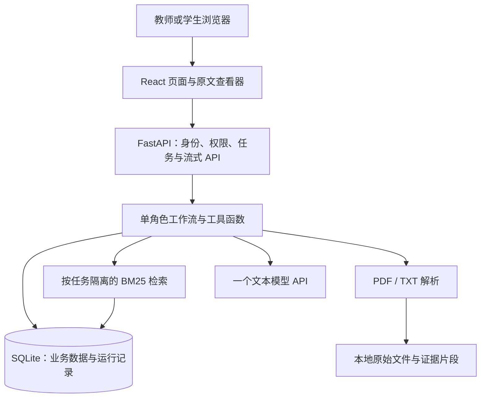

# 阶段一：推荐技术栈与最小实现方案

依据：已确认的《阶段一_单角色沉浸式探究_需求文档.md》。

目标：用尽量少的组件实现完整的单角色探究闭环，同时满足资料解析、来源定位、人工确认、权限隔离和质量验证要求。

本文中的流程、参数、部署规模和选型是推荐方案，不新增或替换需求。官方资料核对日期：2026-11-03；文末列出对应参考资料。

## 一、推荐结论

推荐采用 **React + TypeScript + Ant Design 前端，Python + FastAPI 后端，SQLModel + SQLite 数据存储，pypdf + TXT 资料解析，jieba + BM25 检索，PDF.js 原文查看，一个文本大模型 API，以及代码编排的单角色工作流**。

部署形态为一个应用服务加本地持久化目录。开发时前后端分别启动；交付时将前端构建产物与后端打包，统一提供页面和 API。模型通过后端调用。

这套方案主要压缩基础设施和编排复杂度，保留需求要求的资料能力、教师审核和运行控制。

适用前提：没有必须沿用的企业技术栈；首版用于实习验收和小规模试用；可使用一个获准接入的模型 API。SQLite、内存检索索引和单进程运行控制均按这个范围设计，不承诺未经压测的整班并发容量。

## 二、技术栈及选择原因

| 层次 | 推荐选择 | 负责的功能 | 选择原因与边界 |
| --- | --- | --- | --- |
| 前端 | React + TypeScript + Vite | 教师配置、学生对话、笔记、成果与报告页面 | 使用 React/TS 模板起步，按页面拆组件；本项目没有搜索引擎收录需求，首版采用普通单页应用。[S1] |
| UI | Ant Design | 表单、上传、表格、弹窗、抽屉等 | 直接复用现成组件，将开发精力放在业务逻辑上。[S2] |
| 后端 | Python + FastAPI | 登录、任务、文件、会话、工具执行与流式接口 | 将资料处理和模型调用放在同一语言的后端；SQLModel 提供与 FastAPI 配合的用法，FastAPI 提供流式响应支持。[S3][S4] |
| 数据校验 | Pydantic | RoleCard、工具参数、模型输出和接口输入校验 | 把模型输出转换为可检查的数据，校验失败时执行有限修复。[S5] |
| 数据库 | SQLModel + SQLite | 用户、任务版本、角色卡、对话、证据、笔记、运行记录 | 原型阶段减少独立数据库部署；SQLModel 可衔接 FastAPI 数据模型与数据库操作。[S3] |
| 文件存储 | 本地持久化目录 | 原始 PDF/TXT、必要的解析产物 | 与数据库一同备份；文件通过鉴权接口读取，不直接公开目录。 |
| 资料解析 | pypdf + Python 文本读取 | 带文本层的 PDF、TXT | 用两类格式满足当前最低要求；PDF 保留页码，TXT 保留段落和行号。pypdf 不提供 OCR。[S6] |
| 检索 | jieba + rank-bm25 | 对当前任务资料片段进行中文分词与相关性排序 | 在应用进程内完成检索，首版无需部署检索服务。BM25 的语料和查询必须采用一致的预处理。[S7][S8] |
| 原文查看 | PDF.js + 普通文本查看器 | 点击引用打开 PDF 对应页或 TXT 对应段落 | PDF.js 提供读取和渲染指定页面的能力；文本使用稳定的行号、段落锚点。[S9] |
| 模型接入 | 一个文本模型 API + HTTPX 适配层 | 角色卡、问题链、角色回答和语义核验 | 统一管理超时、取消、输出解析和模型配置；HTTPX 提供异步请求与流读取能力。[S10] |
| Agent 编排 | Python 显式流程 + 工具注册表 | 执行步骤、状态、确认、停止和重试 | 当前业务流程已明确，用普通函数和状态枚举实现，便于逐条对应验收。 |
| 流式交互 | SSE + 浏览器 Fetch 流读取 | 回答分段返回、运行状态、终止通知 | 采用 HTTP 事件流；前端停止请求配合后端取消接口。[S4][S11] |
| 测试 | pytest + 少量 Playwright 用例 | 后端规则、权限、资料定位与完整交互 | 分别覆盖业务逻辑和浏览器闭环，再补真实模型的人工评阅。[S12][S13] |

### 模型选择建议

优先复用已有企业模型网关；若没有，建议以 **阿里云百炼 Qwen-Plus 系列的可用文本模型**作为首个验证候选，通过后端 HTTP 接口调用。其官方文档提供结构化输出和流式输出能力说明；Qwen-Plus 的结构化输出需使用受支持的非思考模式，JSON Schema 支持范围还需按具体模型和地域核对。[S14][S15]

建议用以下条件决定是否最终采用，而不是只看模型名称：

1. 能稳定输出完整 RoleCard，并通过 Pydantic 校验。
2. 在三个主题案例上通过连续 10 轮一致性、未来事件拦截、私人动机不编造等验收。
3. 对中文材料引用正确，能够提出有意义的证据追问。
4. 调用延迟和实际费用能被项目接受。

角色生成优先采用供应商支持的 JSON Schema 模式；若具体模型只支持 JSON Object，则使用 JSON Object 加本地校验和有限修复。JSON 格式有效不代表字段、史实或引用正确。[S14]

首版共用一个模型，不训练、不微调、不自建 GPU 推理服务。验收时记录并尽可能固定模型快照、Prompt 版本及配置；不在方案中编造固定成本或响应时间，实际用例跑通后再测量。

## 三、整体结构



前端承担展示与操作，后端负责权限、资料范围、引用生成、工作流和发布控制。模型只返回候选内容与判断，不能绕过后端直接操作数据库、读取任意文件或发布任务。

## 四、页面与业务闭环

推荐合并为六类页面，教师和学生使用同一个应用：

| 页面 | 最小功能 |
| --- | --- |
| 登录与任务列表 | 预置教师、学生账号；显示各自有权限的任务。 |
| 教师任务编辑 | 填写主题等字段、上传资料、设置外部知识范围、生成和编辑一个 RoleCard。 |
| 教师预览与发布 | 使用与学生相同的对话流程预览；展示待确认版本和发布对象；确认后发布。 |
| 学生探究 | 角色卡和 AI 模拟标识、推荐问题、自由对话、停止、重试、来源抽屉、笔记。 |
| 学生成果 | 按结论、证据、反方观点、观点变化、未解决问题和反思填写；学生确认提交。 |
| 教师报告 | 按学生查看对话、笔记、成果，以及可定位到具体消息的越界和风险记录。 |

阶段小结可由模型整理已经出现的观点和待解决问题；最终立场与成果正文由学生填写。报告主要通过数据库查询与固定模板生成，不增加额外的“报告 Agent”。

必填字段先用普通表单校验处理；需要 Agent 澄清时，每次最多列出三个缺失项，已确认字段存入 TaskBrief，避免重复询问。

## 五、资料与来源：最小但完整的实现

### 1. 首版选择 PDF 和 TXT

推荐首先支持 **带文本层的 PDF 与 TXT**，这对应需求允许选择的两类资料。教师输入字段列举“文档、图片、文本”，不意味着首版必须实现五种格式；具体最低要求仍是“至少两类”。

- PDF：pypdf 按页提取文本；保留原始文件、页码、页内片段编号和引用原文。
- TXT：按约定编码读取，保留原始文件、行号范围、段落编号和引用原文。
- 不支持的格式应在上传入口明确说明，不先接受再静默丢弃。
- 图片型、加密或严重解析异常的 PDF 返回明确错误；扫描件需转换为可解析资料后使用。pypdf 不具备 OCR 能力，不能将图片型 PDF 上传成功当作解析成功。[S6]

这个选择是首版的格式支持边界。如果实际验收材料以扫描件或图片为主，就需要在开发前将 OCR 纳入范围，不能仅凭文件后缀宣称满足资料处理要求。

### 2. 保留可定位的证据片段

资料解析时创建 `Source` 与 `Evidence` 记录：

| 对象 | 建议保存的字段 |
| --- | --- |
| Source | 文件 ID、所属任务版本、原始文件名、受控存储路径、文件类型、内容哈希、解析状态。 |
| Evidence | 片段 ID、文件 ID、原文、PDF 页码或 TXT 行号范围、段落编号、教师确认的角色可用范围、争议标记。 |

按段落切片，PDF 片段尽量不跨页。长段落再拆分，并保留稳定位置。片段长度、召回数量等是开发参数，应通过样例调整，不写死为产品验收条件。

引用位置由解析器和后端产生。模型只选择后端已经提供的片段 ID，不能生成任意文件名、URL 或页码。

### 3. 检索与回答依据

推荐从以下流程开始：

1. 按当前学生权限、任务版本及教师确认的资料范围筛选候选片段。
2. 使用 jieba 对查询和片段做一致分词，以 BM25 排序。[S7][S8]
3. 提供问题、近期必要对话、RoleCard 和候选证据给模型。
4. 模型给出回答类型、引用片段 ID 和追问；后端检查引用是否确实来自本次允许使用的证据。
5. 再检查原文是否支持该结论，以及该信息是否符合角色的时间和认知边界。

检索命中不等于答案成立；排序分数也不是“事实可信度”。当片段无法支持结论时，输出“现有资料无法确认”。不同资料冲突时保留各方来源，避免只保留支持第一种说法的片段。

**选择 BM25 的原因：**首版围绕几个受控主题及有限材料开展，先用可检查的片段检索减少基础设施。这个方案是否足够，需要用真实中文提问验证，不能预设关键词匹配一定能覆盖所有同义表达。

如果同义问法或较长问题导致持续漏检，先在同一应用内补充查询改写，或使用一个 embedding 接口配合进程内向量相似度计算。只有出现明确规模或性能需求时，再引入专用向量数据库。

### 4. 点击来源定位原文

- PDF 引用包含来源 ID、页码和引用片段。点击后，后端鉴权返回原始 PDF，PDF.js 打开对应页，同时展示被引用的原文片段。[S9]
- TXT 引用打开原始文本视图，滚动并高亮相应行号或段落。
- 首版以“准确打开来源页或段落”为定位目标。PDF 精确坐标高亮可以后续增强，不能用一段脱离原文件的摘要代替原文定位。
- 文件和片段按版本保留；替换资料创建新版本，避免历史回答的引用跳到新文件的错误位置。

### 5. 资料非必填如何处理

教师不上传资料时，仍必须遵守其设置的外部知识范围：

- 可以使用教师明确确认的角色事实作为上下文，并标明该来源是教师配置。
- 允许外部知识时，模型可提供明确标记的背景说明或观点；没有可核验来源的内容不能包装为“资料事实”，也不能编造可点击引用。
- 如果需要给某项事实提供原文引用，就需要导入或提供相应材料。首版不额外接入联网搜索工具。
- 资料不足且不允许外部知识时，明确无法确认，同时提出有助于补充证据的问题。

## 六、角色一致性与单角色工作流

### 1. 用显式流程连接工具

推荐将学生一轮对话实现为：

```text
校验身份、任务版本、轮次和停止状态
    → 读取 RoleCard、会话摘要与近期消息
    → 检索当前允许使用的证据
    → 生成候选回答与追问
    → 校验结构、引用、角色一致性和认知边界
    → 返回通过检查的内容
    → 保存消息、引用、风险记录与会话状态
```

角色创建、问题链规划、学生对话和报告整理各使用一个清楚的入口。当前任务不需要让模型自行决定无限循环、随意调用工具或管理其他 Agent。

### 2. RoleCard 每轮固定注入

Pydantic 定义需求中完整的 RoleCard 字段。教师确认后作为当前任务版本的角色约束，每轮都传入，不仅在首轮发送。[S5]

重点检查：

- 是否保持身份、时间、地域、立场与语言风格。
- 是否把模型知道的未来事实，当成角色当时知道的信息。
- 是否把资料中的一般描述改写为真实人物亲历、原话或确定的私人动机。
- 是否把学生的猜测或历史对话中的错误当成已经确认的资料事实。
- 是否只给出结论、直接表扬或代写，而没有追问依据。

**时间边界不能简单按资料出版时间过滤。**后世研究可能描述角色当时可以知道的事件；同一份资料也可能同时包含过去和未来内容。应结合片段内容、教师确认的 `knownFacts / unknownFacts` 与回答核验处理。

### 3. 规则检查与语义检查分工

- 程序负责确定性约束：Schema、角色类型、引用 ID、权限、版本、最大步骤、发布确认等。
- 模型辅助判断：原文是否支持结论、是否存在时代错置、是否编造私人动机、追问是否有教学意义。
- 复用同一个模型执行核验函数，不增加一个独立运行的审核 Agent。
- 修复后仍未通过时，返回符合角色身份的“无法确认”或边界说明，停止继续扩写。

同一个模型复核可能重复原模型的错误，因此这只能降低风险，不能代替教师审核和真实验收测试。

### 4. 会话记忆

数据库保留完整消息；模型上下文只装载“固定 RoleCard + 摘要 + 最近若干轮 + 本轮证据”。达到配置的上下文预算时更新摘要，不无限拼接全文。

摘要区分学生观点、已确认事实、未解决问题和已经提出的追问。摘要不能改写 RoleCard 的知识边界；引用仍通过片段 ID 关联。

教师修改时间锚点、目标或资料范围后，创建新版本并使原确认失效，重新校验角色卡和问题链。历史学生会话固定使用原已发布版本，新版本确认发布后用于新的会话，避免旧摘要污染新角色。

## 七、工具设计：首版实现六个

需求规定至少设计四个工具。推荐实现以下六个，它们直接覆盖资料、角色、核验、草稿与发布：

| 工具 | 最小输入 | 最小输出 | 属性与确认 |
| --- | --- | --- | --- |
| `parse_material` | 文件 ID、任务草稿版本 | 解析状态、来源元数据、证据片段 ID | 写入；校验教师权限，替换已确认资料时使确认失效。 |
| `retrieve_evidence` | 任务版本、问题、角色 ID | 候选片段、来源位置、相关性排序 | 只读；限定当前有权访问的资料范围。 |
| `generate_role_cards` | TaskBrief、可用资料、已有教师编辑 | 一个 RoleCard、开场语、推荐问题与问题链 | 默认返回候选结果；覆盖教师编辑前必须确认。 |
| `check_role_consistency` | RoleCard、问题、候选回答、引用片段 | 是否通过、问题类型、对应位置及修复建议 | 只读；程序校验结合模型语义检查。 |
| `save_task_draft` | 草稿 ID、期望版本、变更内容 | 新版本号、校验结果、待确认项 | 写入；校验教师权限和版本冲突。 |
| `publish_task` | 版本 ID、确认记录 ID、发布对象、幂等键 | 发布结果及发布版本 | 高风险写入；教师对当前版本的有效确认是前置条件。 |

其余功能仍实现，但不必都包装为独立工具：

- 问题链随角色生成，后续追问在对话流程中完成。
- 教师预览调用同一对话工作流，使用单独的预览会话。
- 教师报告使用数据库查询与页面模板聚合。

工具用普通 Python 函数、统一输入输出模型和注册表实现。首版无需额外部署 MCP Server。即便发布工具存在于注册表，模型也不能凭一段文本确认直接执行发布。

所有工具统一返回 `result / error_code / retryable`，设置超时、读写属性和确认要求。自动重试最多两次，即首次执行加两次重试；参数、权限和确认错误不重试。重试也计入当前 Run 的总步骤与时限。

## 八、流式输出、停止与运行状态

### 1. 真正停止运行

建议的 Run 状态包括 `running`、`waiting_confirmation`、`completed`、`failed`、`cancelled`，另保存当前步骤、重试次数和终止原因。

- 开始执行前写入 Run；每次进入工具或模型调用前检查取消标记及步骤预算。
- 浏览器“停止”调用后端取消接口，同时中断当前 Fetch 流；AbortController 只负责浏览器端请求，后端仍需要显式取消对应任务。[S11]
- 后端取消异步模型调用、关闭 HTTP 流，并停止后续工具步骤。供应商已完成的处理不一定能被撤回。
- 一个会话同时只允许一个活跃 Run，避免双击发送造成消息顺序错乱。
- 进程重启后，将未完成 Run 标为中断并允许用户重新发起；首版不实现检查点自动续跑。

### 2. 回答按段核验后流式发送

推荐采用小段落作为输出单元。模型以约定的 JSON Lines 形式流式输出回答块，每个完整块含 `type / text / evidence_ids`；后端累积到一整行后，用 Pydantic 校验并核验来源与角色边界，通过后立即向前端发送该段，后续段继续处理。

这里的 JSON Lines 是应用层约定，不假定供应商的单个 JSON Object/Schema 模式能够直接生成多个独立 JSON 对象。角色卡继续使用普通结构化输出模式；对话块解析失败进入有限修复或停止流程。[S14]

回答较短时可能只有一个块；多段回答可以在整篇完成前逐段展示。每段的语义核验会增加模型调用和等待，首版应限制回答长度和块数。共享一次检索结果，不为每段重新检索。

若后续核验失败，停止后续输出并明确本轮未完整完成；已发送的合格段保留为部分结果，不计为正常完成轮次。未完成内容不自动进入摘要。

不建议把整篇生成后通过前端定时器逐字播放，冒充模型实时输出；也不建议先将未检查的事实展示给学生，再依赖结束后的检查追溯纠错。

模型调用用 HTTPX 异步流读取，浏览器采用 Fetch 读取后端 `text/event-stream`。两者均需显式关闭流；服务端和代理不应缓冲整个响应。[S4][S10][S11][S15]

## 九、数据、权限与人工确认

### 1. 数据存储建议

建议按以下业务对象组织数据，首版不必把所有 JSON 子结构拆成表：

- `User / LoginSession`：账号、角色、会话有效期。
- `Task / TaskVersion / TaskMember`：主题、发布快照、参与学生及授权教师。
- `RoleCard`：按任务版本保存一个结构化角色卡。
- `Source / Evidence`：不可随意覆盖的资料原件及片段。
- `RoleSession / Message / Citation`：学生会话、消息与引用映射。
- `ExplorationNote / Submission`：学生笔记、最终成果及提交时间。
- `AgentRun / RunStep / ReviewRecord`：运行、错误、回答核验及教师确认记录。

SQLite 开启外键约束，使用短事务；需要 WAL 时使用受支持的已修复版本并进行环境验证。WAL 允许读写并行，但同一时刻仍只有一个写入者，而且不适合多个主机通过网络文件系统共享数据库。[S16]

模型调用和文件解析期间不要持有数据库写事务。检索索引缓存按任务版本划分，可从 Evidence 重建，不把缓存作为唯一数据来源。

### 2. 最小账号与授权

首版采用预置教师/学生账号，不做注册、短信、邮箱或企业 SSO。密码使用 `pwdlib` 的 Argon2 哈希，参考 FastAPI 官方安全文档。[S17]

建议使用随机会话 ID 加服务端会话记录，通过 HttpOnly Cookie 传递；部署时启用 HTTPS、Secure、SameSite，并对写操作校验 CSRF/来源。身份与业务权限从服务端数据推导，不能相信前端传入的角色名称或学生 ID。

每个任务、会话、成果、原文件下载接口都检查所有权或授权关系。学生甲拿到学生乙的会话 ID，也不能读取其消息、引用和成果。

### 3. 发布确认不能交给模型判断

教师点击确认时记录操作者、操作类型、任务版本、资料范围和时间。`publish_task` 在事务内检查确认记录绑定的版本与当前待发布版本一致，并检查发布对象。

发布、修改已发布任务、删除和覆盖人工编辑都按需求设置确认步骤。版本改变后旧确认失效；幂等键与版本检查防止重复发布或覆盖并发修改。

## 十、Trace and Evals 的最小实现

Trace 存在现有数据库和教师报告页面中，记录消息 ID、RoleCard/任务版本、证据片段 ID、模型及 Prompt 版本、核验结果、工具错误和终止原因。教师点击风险记录能跳到对应消息及资料。

不保存或展示模型内部推理过程；保留可解释的检查结论，例如“引用片段未支持该事实”或“超出角色时间锚点”。

Evals 采用“程序检查 + 真实模型样例 + 人工评分表”：

| 检查内容 | 最小验证方法 |
| --- | --- |
| RoleCard 字段齐全 | Pydantic 校验及必填字段测试。 |
| 连续 10 轮一致性 | 固定对话脚本，人工检查身份、时间、立场和语言；模型核验结果供辅助定位。 |
| 未来事件与私人动机 | 准备具体问题及预期边界，不用固定字符串匹配代替语义判断。 |
| 来源准确性 | 程序检查引用存在、属于本任务且位置正确；人工检查原文是否支持回答。 |
| 资料能力 | PDF/TXT 均能解析；点击分别定位页面和段落；扫描件与坏文件有明确错误。 |
| 探究深度 | 学生只有结论时是否追问理由、证据或反例，是否避免直接代写。 |
| 时间锚点修改 | 确认失效、角色已知与未知信息及问题链重新校验、旧会话版本不被静默替换。 |
| 权限与确认 | 学生不能发布或读他人会话；缺确认及过期确认不能发布；重复请求不重复写入。 |
| 停止与重试 | 停止后无后续调用；超时和失败按上限结束；中断结果不成为完整会话事实。 |
| 注入与冲突 | 资料中的指令不能改变角色与权限；冲突证据并列展示，无支持时不伪造引用。 |

pytest 覆盖确定性规则和接口，Playwright 只覆盖少量关键浏览器闭环。[S12][S13] 再为三个主题分别保留测试资料、真实对话和评阅记录，不预先要求搭建独立评测平台。

## 十一、实施顺序

| 顺序 | 要完成的内容 | 完成标志 |
| --- | --- | --- |
| 1 | 账号、权限、任务草稿、版本及 RoleCard 表单 | 能保存一个任务，教师确认记录有效且可校验。 |
| 2 | PDF/TXT 解析、证据存储、原文查看 | 从页面点击测试引用，能打开正确页或段落。 |
| 3 | 角色卡生成、教师编辑与预览 | RoleCard 字段完整，修改后能重新校验。 |
| 4 | 检索、单角色对话、回答核验、流式输出与取消 | 能连续对话并追问；边界问题被正确处理。 |
| 5 | 发布、学生笔记、阶段小结、最终成果和教师报告 | 从教师创建到学生提交、教师回看闭环完成。 |
| 6 | 三个主题案例、七项验收及通用要求测试 | 形成测试记录、演示视频和技术复盘。 |

优先做来源定位的纵向样例，因为它同时约束文件解析、证据模型、引用输出和前端查看器；若拖到最后，往往需要返工多个模块。

## 十二、部署与后续扩展边界

首版交付一个应用包：前端构建文件、FastAPI 服务、SQLite 数据库和上传目录。使用一个后端进程，进程内限制活跃模型调用数量；文件解析放受限子进程执行，设置文件体积、页数和超时上限。具体上限随测试确定，不宣称任意大小文件均可处理。

数据库与资料一起备份，避免只有对话记录却丢失原文。模型密钥仅在服务端配置中，普通日志不包含密钥和完整敏感正文。

以下组件首版暂不引入：

| 组件 | 当前判断 | 何时再考虑 |
| --- | --- | --- |
| LangChain / LangGraph 等编排框架 | 当前固定流程可由 Python 函数和状态表覆盖。 | 出现复杂分支、长流程恢复或成熟团队已有统一框架时。 |
| 专用向量数据库 | 先验证任务内小规模检索。 | 语料和并发增大，进程内索引不足时。 |
| Redis / Celery 等队列与缓存服务 | 目前采用单进程、有限任务和显式取消。 | 解析任务需要长时间排队、多进程协作或独立任务调度时。 |
| PostgreSQL | 首版 SQLite 减少部署项。 | 多实例部署、真实课堂并发写入或高可用要求明确时。 |
| 对象存储 | 首版使用同机持久化文件目录。 | 多实例共享文件或大规模存储时。 |
| 独立 Trace / 评测平台 | 现有数据库与验收记录能承载当前回查。 | 需要大量模型对比、自动回归或跨环境追踪时。 |
| 自建推理、微调 | 首先验证模型 API 能否满足业务。 | 数据、成本或质量证据证明有必要时。 |

这份选型以降低首次实现成本为前提。如果团队已经有成熟的 Vue、Java 或企业数据库工程模板，沿用现有能力可能更省工作，应保留本文的业务边界与数据约束，替换对应技术组件。

## 十三、主要取舍

1. **只做一个角色，但完整保留资料依据。**减少跨角色协作，不削减来源定位、认知边界和教师确认。
2. **两类文件先做通。**首版 PDF/TXT 的解析失败要明确，不承诺扫描件和图片 OCR。
3. **检索可追溯比检索组件多更重要。**是否升级语义检索，依据真实问题的召回结果决定。
4. **流式与检查同时实现会增加等待。**使用分段核验后返回，接受较慢首段以避免未检查内容先展示。
5. **低组件数量不等于无权限、无版本、无测试。**这些直接影响本次验收，属于首版必做部分。

## 参考资料

以下为核对选型能力的官方文档或项目原始仓库。标记对应文中技术事实；架构、实施顺序和范围取舍为本方案的设计建议。

- [S1] Vite：Getting Started。`https://vite.dev/guide/`
- [S2] Ant Design：Components Overview。`https://ant.design/components/overview/`
- [S3] SQLModel：SQL Databases in FastAPI。`https://sqlmodel.tiangolo.com/`
- [S4] FastAPI：Custom Response。`https://fastapi.tiangolo.com/advanced/custom-response/`
- [S5] Pydantic：Models。`https://docs.pydantic.dev/latest/concepts/models/`
- [S6] pypdf：Extract Text from a PDF。`https://pypdf.readthedocs.io/en/stable/user/extract-text.html`
- [S7] jieba：项目文档。`https://github.com/fxsjy/jieba`
- [S8] rank-bm25：项目文档。`https://github.com/dorianbrown/rank_bm25`
- [S9] PDF.js：Examples。`https://mozilla.github.io/pdf.js/examples/`
- [S10] HTTPX：Async Support。`https://www.python-httpx.org/async/`
- [S11] MDN：Using server-sent events / AbortController。`https://developer.mozilla.org/en-US/docs/Web/API/Server-sent_events/Using_server-sent_events`；`https://developer.mozilla.org/en-US/docs/Web/API/AbortController`
- [S12] pytest：Get Started。`https://docs.pytest.org/en/stable/getting-started.html`
- [S13] Playwright：Installation。`https://playwright.dev/docs/intro`
- [S14] 阿里云百炼：结构化输出。`https://help.aliyun.com/zh/model-studio/qwen-structured-output`
- [S15] 阿里云百炼：流式输出。`https://help.aliyun.com/zh/model-studio/stream`
- [S16] SQLite：Write-Ahead Logging。`https://sqlite.org/wal.html`
- [S17] FastAPI：OAuth2 with Password (and hashing)。`https://fastapi.tiangolo.com/tutorial/security/oauth2-jwt/`
